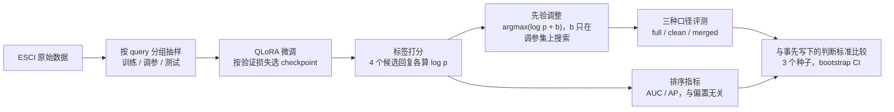

# AI6130 Final Project

## 1. Project Basic Information

- **Course**: AI6130 Large Language Models
- **Project Type** (choose one):
  - [x] Track A: An application of LLMs for real-world applications
  - [ ] Track B: A new architecture / new techniques for training / finetuning LLMs
- **Topic**：电商搜索相关性判断。在 Amazon ESCI 数据集上微调 Qwen2.5-7B-Instruct，判断 query 与商品是什么关系。

**一句话结论**：推荐方案是 QLoRA 微调 1 个 epoch，推理时再做先验调整。宏 F1 从零样本的 0.384 提高到 0.548，三个种子的范围是 [0.541, 0.554]。之后十余项改进都没能在 3 个种子上稳定超过它。瓶颈主要在标注质量，不在训练技巧。换成 14B 基座（N1）的初步结果是宏 F1 0.564，三个种子都高于 7B 的范围，但两边的打分协议还没统一，暂不算最终结论。

## 2. 任务与数据

| 方面 | 内容 |
| --- | --- |
| 任务 | 输入 query 与商品标题，输出四类之一：exact（完全满足）、substitute（可替代）、complement（可搭配）、irrelevant（不相关）。输出是 JSON，例如 `{"relevance": "complement"}` |
| 数据 | [Shopping Queries Dataset (ESCI)](https://github.com/amazon-science/esci-data)，美国英文 |
| 数据划分 | 按 query 分组抽样：训练集 5,000 个 query（2 万条），调参集 1,500 个 query（6,000 条），测试集 2,500 个 query（1 万条）。三个集合没有共同的 query |
| 类别分布 | exact 约 67%，substitute 约 20%，irrelevant 约 8%，complement 约 2% |
| 主指标 | 宏 F1，因为只看准确率会被 exact 主导；同时报告准确率 |
| 统计方法 | 差异都用按 query 分组的 bootstrap 给出 95% 置信区间。关键结论跑 3 个随机种子；只有种子范围不重叠，才算“稳定提升” |
| 模型 | Qwen2.5-7B-Instruct；LLaMA-Factory 0.9.5；QLoRA（4bit NF4，r=16，alpha=32，全部线性层，可训练参数 0.53%） |
| 算力 | NTU CCDS 集群，单卡 L40S 48 GB（SLURM）；NSCC ASPIRE-2A（PBS） |

## 3. 实验流程



1. **数据**：`prepare_esci` 按 query 抽样并划分，确保三个集合没有共同的 query，官方 train/test 之间共享的 query 也已剔除。
2. **训练**：E2a 是默认设定，训练 1 个 epoch、625 步，单卡约 33 分钟。
3. **打分而不是生成**：对 4 个标签的完整回复分别计算对数概率，取最大的作为预测。同一份打分可以同时用于先验调整、召回–精确率曲线和排序指标。
4. **先验调整**：给 4 个类别的对数概率各加一个偏置（exact 固定为 0），偏置在调参集上用坐标上升最大化宏 F1。不需要重训。
5. **噪声感知的评测**：
   - full：完整测试集。
   - clean：去掉标注有争议的 E/S 样本。争议集由不参与比较的模型委员会定义。
   - merged：把 exact 与 substitute 合并成“相关”。
   - 用 clean 和 merged 判断一项提升是不是只出现在标注本身就模糊的样本上。
6. **判断标准事先写下**：从 E8 起，每个实验运行前，先把“什么结果算成功”写进技术日志，再看结果。

每一步的原因、做法、结果和遇到的问题，都记录在 [ecom-query-llm/docs/DEVLOG.md](ecom-query-llm/docs/DEVLOG.md)（章节 S0–S26，问题索引 P1–P20）。

## 4. 主要结果

2,500 个 query 的测试集。“3 种子”表示三个种子的均值，方括号内是最差到最好的种子。

| 方案 | 准确率 | 宏 F1 | 说明 |
| --- | --- | --- | --- |
| 基座零样本 | 0.550 | 0.384 | 未微调 |
| E1：QLoRA，2 个 epoch | 0.727 | 0.534 | |
| E2a：1 个 epoch，按验证损失选 checkpoint | 0.739 | 0.535 | 默认训练设定，训练时间减半 |
| **E2a + 先验调整（3 种子）** | 0.728 | **0.548** [0.541, 0.554] | **推荐方案** |
| E8：追加 1,500 条 complement + 先验调整（3 种子） | 0.732 | 0.551 [0.544, 0.556] | 与 E2a 范围重叠 |
| E10：C、I 各追加 1,500 条 + 先验调整（3 种子） | 0.728 | 0.551 [0.548, 0.555] | 排序质量最好，宏 F1 与 E2a 范围重叠 |
| N2：bf16 LoRA（不量化）+ 先验调整（3 种子） | 0.727 | 0.552 [0.546, 0.555] | 与 E2a 范围重叠 |
| N1：Qwen2.5-14B QLoRA + 先验调整（3 种子） | 0.742 | 0.564 [0.562, 0.565] | 初步：三个种子都高于 E2a 范围，但打分协议尚未与 E2a 统一 |
| 3B 学生（蒸馏方向，人工标签）+ 先验调整（3 种子） | 0.723 | 0.517 [0.510, 0.529] | 低 3.1 个百分点；部署速度快 47 倍 |

## 5. 实验过程与结果

### 5.1 CCDS 单卡阶段：E1–E10（2026-10-20 至 10-27）

| 实验 | 做法 | 结果与结论 |
| --- | --- | --- |
| E1（S8） | QLoRA 微调 2 个 epoch | 宏 F1 从零样本的 0.384 提高到 0.534 |
| E2（S10） | E2a：1 个 epoch 并选最优 checkpoint；E2b：训练时重采样少数类 | E2a 准确率 0.739，训练时间减半，成为默认设定；E2b 宏 F1 0.545，少数类召回升高、精确率下降 |
| R1（S11） | 测试集从 600 个 query 扩大到 2,500 个 | 之前的结论仍然成立；之后都用 2,500 个 query 的测试集 |
| E3（S12） | 推理时先验调整 | 不用重训，宏 F1 +1.45 个百分点（显著），效果与 E2b 相当 |
| E4 / E5（S15） | 训练数据从 2 万条增加到 5 万、10 万、20 万条；3 个种子 | 准确率在约 10 万条后饱和；种子之间可相差 1.3 个百分点，所以关键结论必须用多个种子 |
| E6（S16） | 输入中加入品牌、颜色、商品要点 | 准确率 +0.5 个百分点，但加先验调整后宏 F1 不变，计算量是原来的 1.5 倍，不采用 |
| E↔S 审计（S17） | 抽取所有模型都和原标注不一致的 E/S 样本，由 Claude 盲评 | 约 6.8% 的测试样本 E/S 标注有争议 |
| 噪声感知评测（S18） | 用 clean、merged 两种口径复核 E1–E6 | 加数据、加商品文本带来的提升，几乎都出现在有争议的样本上 |
| E7（S19） | complement、irrelevant 各追加 3,000 条真实样本，再给有争议的 E/S 加软标签 | 主要改变的是模型的先验倾向；complement 的排序有小幅真实提升；软标签没有效果 |
| E8（S20） | 只追加 complement：1,500 / 3,000 / 6,000 条 | 收益在 1,500 到 3,000 条时饱和；6,000 条反而有害，还会拖累 irrelevant |
| E9a（S21–S23） | 先写一句理由再给标签的 SFT（理由由 7B 生成），原计划之后接 GRPO | 宏 F1 降到 0.363，按事先定的标准停止这个方向，不做 GRPO |
| C/I 审计（S24） | 方法同 S17，对象换成 complement / irrelevant | 约 4% 的测试样本粗粒度标注（相关 / 搭配 / 无关）有误；标为 irrelevant 的样本中，约四分之一更像是相关的 |
| E10（S24） | complement、irrelevant 各追加 1,500 条 | 两类的排序质量同时提高（complement AP 0.322 → 0.347，irrelevant AP 0.473 → 0.480），E/S 区分不受损；宏 F1 0.551 仍在 E2a 的种子范围内 |

### 5.2 补充实验：D1–D5（2026-11-02 至 11-04，CCDS 单卡）

判断标准都在运行前写好，见技术日志 S26。

| 项目 | 判断标准 | 结论 |
| --- | --- | --- |
| D1 通用能力 | 达到 | 微调没有削弱通用知识：MMLU 净变化 +0.05 个百分点 |
| D2 LoRA 超参 | 有结论 | 默认的 r=16、全部线性层合适 |
| D3 意图 / 属性 / 改写 | 未达到 | 7B 自标注的条件下没有提升；流程已跑通 |
| D4 蒸馏与部署 | 部分达到 | 推荐部署 3B 人工标签版，配合 vLLM 每秒 399 条 |
| D5 中文扩展 | 达到 | Multi-CPR 重排 MRR@10 从 0.256 提高到 0.346 |

**D1 · 通用能力回归**：MMLU 5-shot，57 个学科，14,042 题，4bit 加载。

| 模型 | 准确率 | 相对基座（配对 bootstrap 95% CI） |
| --- | --- | --- |
| 基座 Qwen2.5-7B-Instruct | 0.7349 | — |
| E2a seed 42 / 43 / 44 | 0.7353 / 0.7355 / 0.7353 | +0.04 / +0.06 / +0.04 个百分点，CI 下限最低 −0.27 |

- 四大类（STEM、人文、社科、其他）的变化都在 ±0.5 个百分点以内。
- 约 4.5% 的题目换了答案，对错互相抵消。准确的说法是“通用能力没有净变化”。

**D2 · LoRA 超参消融**：每个设定 3 个种子，与 E2a 比较。

| 设定 | 可训练参数 | 训练时间 | full 宏 F1 | merged 宏 F1 | E-vs-S AUC |
| --- | --- | --- | --- | --- | --- |
| E2a（r=16，全部线性层） | 40.4M（0.53%） | 32.6 分钟 | 0.548 [0.541, 0.554] | 0.585 [0.576, 0.593] | 0.847 |
| r=8 | 20.2M | 32.5 分钟 | 0.535 [0.520, 0.543] | 0.571 [0.552, 0.583] | 0.843 |
| r=64 | 161.5M | 32.9 分钟 | 0.548 [0.535, 0.563] | 0.587 [0.566, 0.608] | 0.853 |
| 只训练 q、v（r=16） | 5.0M | 24.4 分钟 | 0.515 [0.510, 0.524] | 0.554 [0.550, 0.561] | 0.827 |

- r=8：小幅下降，但与 E2a 范围重叠。
- r=64：参数是 4 倍，宏 F1 不变，只有 E/S 排序略好。
- 只训练 q、v：在 full 和 merged 两种口径下都稳定变差 3.2 个百分点，说明 MLP 层的适配是必要的。

**D3 · 意图、属性、改写（多任务）**
- 标注：没有公开标签，所以用 7B 基座零样本标注真实的 ESCI query，再做规则校验。训练与验证集 5,250 个 query，通过 97.4%。
- 抽查 100 条（Claude 逐条判断）：
  - 意图 94 条合理。
  - 属性 12 条把值放错了字段，约 17 条漏掉了 query 里写明的品牌或尺寸。
  - 改写 2 条丢掉了约束。
- 多任务训练对相关性的影响：准确率稳定低 0.9 个百分点，宏 F1 −0.5 个百分点（CI 含 0）。不算“不伤害”，也不算“有害”。
- full 任务（1 个种子）：格式合法率 100%，意图准确率 0.963，属性 F1 0.773。但参照本身就是 7B 的标注，衡量的是“学得像不像标注模型”。
- 改写对 BM25 检索的帮助：Recall@10 +0.12 到 +0.32 个百分点，只有一个设定的置信区间整体高于 0。原因是只改动了约 6% 的 query。
- 结论：流程能跑通，但受标注质量限制，没有得到有用的提升。计划换更强的标注模型重做。

**D4 · 蒸馏与部署**
- 教师：E2a 加先验调整。
- 学生：Qwen2.5-1.5B / 3B，bf16 LoRA。
- 三种训练数据：
  - gold：2 万条人工标签。
  - t20k：同样的 2 万条，标签换成教师标签。
  - t50k：5 万条，全部用教师标签。

| 学生 | full 宏 F1（3 种子） | 相对 gold |
| --- | --- | --- |
| 1.5B gold | 0.442 [0.437, 0.450] | — |
| 1.5B t50k | 0.496 [0.445, 0.532] | 平均 +5.4 个百分点，但有一个种子落在 gold 范围内 |
| 3B gold | **0.517** [0.510, 0.529] | — |
| 3B t50k | 0.498 [0.460, 0.519] | −1.9 个百分点 |

| 部署方式（单卡 L40S） | 吞吐（条/秒） | 单条延迟 p50 |
| --- | --- | --- |
| 教师 7B，HF 4bit，现行打分（4 个候选各算一次） | 8.5 | — |
| 教师 7B，HF 4bit，只看第一个不同的 token | 35.0 | 60 ms |
| 3B，HF，只看第一个不同的 token | 61.6 | 34 ms |
| 3B，vLLM，只看第一个不同的 token | **398.6** | 14.5 ms |
| 1.5B，vLLM，只看第一个不同的 token | 762.4 | 9.2 ms |

- 宏 F1 的差异几乎全部来自 complement（占 2%）。1.5B 用人工标签几乎学不会这一类；教师标签让它在 3 个种子中的 2 个里学会了。3B 本来就学得会，教师标签只带进了教师自己的错误。
- “只看第一个不同的 token”：4 个标签在第一个不同的 token 之前完全相同，所以一次前向就能比较，吞吐提高约 4 倍。学生与现行打分方式的预测一致率为 99.2–99.3%。
- 教师放到 vLLM 的 bf16 基座上，与 4bit 预测只有 86% 一致。原因是 QLoRA 适配器在 4bit 基座上训练，换精度推理时数值对不上。学生用 bf16 训练，没有这个问题。
- 推荐：部署 3B 人工标签版加 vLLM。宏 F1 只比教师低 3.1 个百分点，速度是教师现行打分的 47 倍。

**D5 · 中文扩展**：Multi-CPR 电商子集。约 100 万个商品，开发集 1,000 个 query，在 BM25 前 20 名上重排。

| 系统 | MRR@10 | Recall@1 | Recall@10 |
| --- | --- | --- | --- |
| BM25（字一元 + 二元） | 0.266 | 0.190 | 0.442 |
| 零样本 7B | 0.256 | 0.179 | 0.460 |
| 微调 7B（1 万个 query，3 种子） | **0.346** [0.346, 0.347] | 0.274 | 0.499 |
| 上限（前 20 名召回） | 0.534 | 0.534 | 0.534 |

- 微调相对零样本：MRR@10 +9.0 个百分点，三个种子的 CI 都整体高于 0。
- 局限：每个 query 只标注了一个正例，难负例里可能有其实相关的商品。

### 5.3 NSCC 阶段：N0 复现与 N2 量化对照（组员，[EXPERIMENT_RESULTS.md](EXPERIMENT_RESULTS.md)）

| 实验 | 设定 | 先验调整后准确率 | 先验调整后宏 F1 | merged 宏 F1 |
| --- | --- | --- | --- | --- |
| N0 | 在 NSCC 上复现 E2a seed 42（4bit QLoRA） | 0.7300 | 0.5493 | 0.5858 |
| N2 | bf16 LoRA，不量化基座，3 个种子 | 0.7273 | 0.5516 [0.5460, 0.5546] | 0.5924 |
| E2a 对照 | 4bit QLoRA，3 个种子 | 0.7284 | 0.5479 [0.5405, 0.5538] | 0.5849 |

- N0 与 CCDS 上的 E2a seed 42 结果完全一致，跨集群复现通过。
- N2 比 E2a 高 0.38 个百分点，但两组种子范围重叠，按标准没有稳定提升。同种子下 N2 − N0 为 +0.51 个百分点，CI [−0.67, +1.85] 含 0。
- 结论：4bit 量化没有可测出的损失；但这不能证明量化“完全没有损失”。

### 5.4 标注人工复核：B1–B3（组员，[B3_RESULTS.md](B3_RESULTS.md)）

组员对两份 Claude 盲评审计表（S17、S24）做了人工复核。

| 审计 | 样本 | 疑难组中人工支持模型 / 支持原标注 | 人工与 Claude 一致率 | 外推“人工支持模型”的比例 | Claude 原估计 |
| --- | --- | --- | --- | --- | --- |
| B1：E↔S | 120 条 | 52 / 19（共 100 条） | 68.3%（都给出确定判断时 75.7%） | 5.74% | 6.79% |
| B2：R/C/I | 130 条 | 52 / 37（共 110 条） | 70.0%（都给出确定判断时 77.7%） | 4.17% | 4.05% |

- 对照组的人工判断与原标注一致率为 85% 和 95%，说明复核标准合理。
- 人工复核与 Claude 的方向一致：模型一致反对原标注的样本里，确实有相当一部分是标注有争议。
- 外推比例是“人工支持模型的比例”，不是已逐条证实的错误标签率。B1、B2 可能有重叠，不能相加。

### 5.5 模型容量：N1 Qwen2.5-14B（组员，[ecom-query-llm/reports/n1/](ecom-query-llm/reports/n1/README.md)）

只把 E2a 的基座从 Qwen2.5-7B-Instruct 换成 Qwen2.5-14B-Instruct，数据、提示词、QLoRA 超参和有效 batch 都不变。判断标准运行前写在技术日志 S27。

| 种子 | 最优 checkpoint | 训练时间 | 先验调整后准确率 | 先验调整后宏 F1 |
| --- | --- | --- | --- | --- |
| 42 | 625 | 2.26 小时 | 0.7330 | 0.5642 |
| 43 | 400 | 2.36 小时 | 0.7426 | 0.5646 |
| 44 | 625 | 2.45 小时 | 0.7491 | 0.5617 |
| **均值** | — | 共 7.06 GPU 小时 | **0.7416** | **0.5635** [0.5617, 0.5646] |

- 硬件：AutoDL 单卡 RTX 5090 32 GB，而不是原计划的 A100 80 GB。为放进显存，micro-batch 改为 1、梯度累积 32，有效 batch 仍是 32。
- 与 E2a 相比：E2a 三个种子为 [0.5405, 0.5538]，N1 的三个种子都更高，均值高约 1.6 个百分点。
- **还不是最终结论**：N1 打分时开启了 4bit 的 double quantization，与训练时一致；历史 E2a 的打分没有开启。要先用同一协议重新给 E2a 三个适配器打分，再补做 clean/merged、bootstrap 和排序指标，才能判断是否“稳定提升”。E2a 三个适配器保留在 CCDS 上。

## 6. 结论

1. **稳定的收益只有两项**：
   - 微调本身：宏 F1 0.384 → 0.535。
   - 推理时先验调整：宏 F1 +1.45 个百分点，不用重训。
   - 加数据、加商品文本、调类别比例、软标签、先推理再分类、改 LoRA 秩、不量化，收益都在种子差异之内，或者有害。
2. **标注质量是主要瓶颈**：约 6% 的 E/S、约 4% 的 C/I 测试样本标注有争议，已由人工复核确认方向（B1–B3）。很多“提升”只出现在这些样本上。
3. **调整类别比例 ≈ 调整先验**：大部分可以用推理时调偏置代替；只有 E10（C、I 各 1,500 条）带来了真实的排序提升。
4. **工程上可落地**：
   - 微调没有损伤通用能力（D1）。
   - 4bit 量化没有可测损失（N2）。
   - 3B 学生加 vLLM 能以 47 倍速度部署，宏 F1 只低 3.1 个百分点（D4）。
   - 同样的方法迁移到中文重排也有效（D5）。
5. **模型容量可能是另一个瓶颈**：14B 的三个种子都高于 7B（0.564 对 0.548），这是目前唯一一个种子范围不重叠的改进；统一打分协议后才能确认（N1）。

## 7. 局限与下一步

- **模型容量**：14B（N1）的结果还缺统一协议的 E2a 对照；全参数微调尚未做，计划见 [NSCC_PLAN.md](ecom-query-llm/docs/NSCC_PLAN.md)。
- **D3 的标注**：用 7B 自己标注，质量是主要局限，计划用 72B 重新标注（N4）。
- **标注审计**：每组只有 20–50 条样本，比例有抽样不确定性。组员的复核过程中讨论过少数边界案例，因此不是完全独立的第二位判断人。
- **测试集**：只用了 ESCI 的美国英文子集；D5 的中文实验只有一个正例标注。

## 8. 前端演示

`demo/` 是一个静态网页，演示模型放进电商搜索后能做什么。它只用模型在留出集上的真实打分，不做在线推理。

- **英文搜索**：可以搜索 ESCI 测试集的 2,500 个真实搜索词。
  - 每个商品显示模型判断（完全匹配、可替代、可搭配、不相关）和四类概率，并与人工标注对照。
  - 完全匹配和可替代的商品排在主结果里，可搭配的进“搭配购买”栏，不相关的折叠起来。
  - 可以开关“推理时先验调整”，页面会用 1 万条打分现场重算准确率和宏 F1（0.740 / 0.534 ↔ 0.730 / 0.549）。
- **中文重排**：Multi-CPR 电商开发集的 1,000 个搜索词，左右对比 BM25 前 20 名和大模型重排的结果，可以切换零样本与微调模型。
- **项目成果**：关键数字、模型在搜索链路中的位置、效果与部署速度。

本地运行：

```bash
cd demo && python -m http.server 8000
```

然后打开 http://localhost:8000 。数据由 `demo/build_data.py` 从服务器上的打分生成，页面上的指标与项目报告一致。

## 9. 仓库结构与复现

```
ecom-query-llm/            实验代码、配置、脚本、报告与技术日志（保留完整提交历史）
  docs/DEVLOG.md           每一步的原因、做法、结果和问题（S0–S26，P1–P20）
  docs/TEAM_TODO.md        组员待办与 NSCC 上手指南
  docs/NSCC_PLAN.md        NSCC 阶段计划
  docs/N1_AUTODL_GUIDE.md  N1（14B）在 AutoDL 上的运行指南
  reports/                 每个实验的指标与对比 JSON（reports/n1/ 为 14B 三种子结果）
  analysis/                标注审计材料（E↔S、C/I、D3 抽查）
  src/ecomq/               数据处理、训练数据构建、评测（打分、先验调整、噪声感知、排序、MMLU、重排、测速）
  configs/sft/             LLaMA-Factory 训练配置（默认 e2_relevance_qlora_1ep_best.yaml）
  scripts/slurm/           CCDS 作业脚本与各实验的调度脚本
demo/                      前端演示（静态网页与数据）
EXPERIMENT_RESULTS.md      N0 / N2 实验结果
B3_RESULTS.md, B3/         B1–B3 人工复核结果与评分文件
```

复现步骤见 [ecom-query-llm/README.md](ecom-query-llm/README.md) 的“复现”一节。数据、模型和训练产出只放在服务器上，不进 git。

本地单测：

```bash
cd ecom-query-llm && pip install -e ".[dev]" && make test
```

## 10. Team results

- [ecom-query-llm](ecom-query-llm/README.md)：ESCI 相关性四分类的 QLoRA 微调、评测与 D1–D5 补充实验；完整技术日志见 [DEVLOG](ecom-query-llm/docs/DEVLOG.md)，结果文件在 [reports](ecom-query-llm/reports/)。
- 实验记录：[N0 / N2 实验结果](EXPERIMENT_RESULTS.md)。
- [B1–B3 human label audit](B3_RESULTS.md)
- N1 14B 容量实验（`zyq` 分支）：[N1 结果说明](ecom-query-llm/reports/n1/README.md)、[AutoDL 指南](ecom-query-llm/docs/N1_AUTODL_GUIDE.md)。
