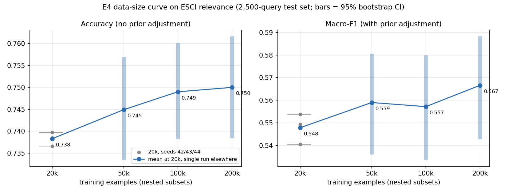

# 技术日志（DEVLOG）

按时间顺序记录每一步：**为什么做、怎么做、效果如何、遇到的问题与解决方式、遗留问题**。
写给三类读者：组员（了解进度与决策）、未来的自己（复现与排错）、面试官（讲清工程取舍）。

约定：
- 服务器主机名、用户名、密码、API Key 一律不写进仓库。文中用 `<ccds-host>`、`<user>` 代替。
- 数字只写实际跑出来的；估算会明确标注“估算”。
- 每个技术问题按「现象 → 原因 → 解决 → 验证」记录，并在下面的索引里登记一行。

## 问题索引

| 编号 | 步骤 | 问题 | 一句话解决 |
|---|---|---|---|
| P1 | S1 | 训练与推理的提示词结构不一致（评测会被系统性低估） | 统一用 `build_user_prompt()`，并加单测锁定 |
| P2 | S4 | 分区内 GPU 未标型号，无法按型号申请 L40S | `--exclude=TC2N0[1-6]` 只留 L40S 节点 |
| P3 | S5 | 导入 peft 报 `torchvision::nms does not exist` | torch/torchvision/torchaudio 从同一个 cu128 源安装 |
| P4 | S5 | 模型只下载了 6 个文件，缺 `config.json` 和分词器 | 去掉 `hf download` 的多模式 `--include`，下载整个仓库 |
| P5 | S5 | transformers 5.x 移除了 `overwrite_output_dir`，配置会解析失败 | 从所有配置删除该参数，依赖 LLaMA-Factory 默认续训 |
| P6 | S5 | transformers 5.x 中 `torch_dtype` 已弃用 | 推理脚本改用 `dtype` |
| P7 | S6 | 代码同步漏传 `src/ecomq/data/`，作业报 `No module named 'ecomq.data'` | 改为只同步 git 跟踪的文件，并在同步后抽查子包 |
| P8 | S6 | QLoRA 适配器配 bf16 基座评测，边界样本判断翻转 | QLoRA 模型评测时用 `LOAD_4BIT=1`，与训练时的量化方式一致 |
| P9 | S6 | `pip freeze` 把含用户名的本地路径写进了锁定文件并已推送 | 改用 `pip freeze --exclude-editable`；历史提交中的残留待决定是否清理 |
| P10 | S7 | 一次性提交整条依赖链被拒：`QOSMaxSubmitJobPerUserLimit` | 每人最多同时提交 2 个作业；改用头节点上的顺序调度脚本 `chain_e1.sh` |
| P11 | S7 | 调度脚本挂在本机 SSH 会话里，断开后可能被 SIGPIPE 终止；`pkill -f` 误杀了执行它的 SSH 会话 | 改用 `setsid nohup` 在服务器上独立运行、直接写日志；`pkill` 的匹配模式不要包含命令行里出现的文本 |
| P12 | S9 | `sbatch --export=...,PREP_ARGS="... complement=0.10,irrelevant=0.20"` 会把值里的逗号当成变量分隔符 | 含逗号的值改为通过环境变量传递，依靠 `--export=ALL` 继承 |
| P13 | S11 | 扩大测试集时断言报错：官方 train/test 有共享的 query | 审计发现仅 1 个（"piano"），E1/E2 测试集不含；改为抽样后剔除共享 query，历史测试集保持不变 |
| P14 | S19 | 报告文件里写入了服务器家目录和本机临时目录的绝对路径（含用户名），已随两次提交推送 | 新增 `redact()` 写报告前替换路径；新增 `scripts/check_leaks.sh` 提交前检查；历史提交待清理 |
| P15 | S19 | “与偏置无关”的排序指标第一版用了 softmax 概率，单测发现加偏置后 AUC 会变 | 改用 log p(c) 排序（softmax 分母含其他类的偏置）；单测锁定不变性 |
| P16 | S20 | 本机临时目录里的调参集、测试集记录被系统自动清理，先验调整报 `FileNotFoundError` | 从服务器重新拉取，核对 id 与标注和残留副本完全一致，并重算一个旧模型复现已提交的报告 |
| P17 | S23 | E9a 测试集评测作业失败：`JSONDecodeError: Invalid \escape` | 模型生成的理由里有 JSON 不允许的转义（如 `\'`），备用解析改为解码失败时宽松处理；补单测，只重跑测试集 |
| P18 | S23 | token 长度检查形同虚设：统计出的最大长度是 2 | transformers 5 的 `apply_chat_template(tokenize=True)` 返回字典，`len` 得到键的个数；改为先渲染文本再分词，加合理性断言，并重新检查已训练的数据（最大 391，没有截断） |

---

## S0 · 项目骨架（2026-10-17）

**为什么**
- 先把「数据格式 → 处理流水线 → 训练配置 → 评测」的接口定下来，后面换数据、换模型、换集群都不用改主干。

**怎么做**
- `src/ecomq/schema.py`：统一 JSON 输出（`intent` / `attributes` / `rewrite` / `relevance`），标签集合与校验规则只在这一处定义。
- 数据流水线：`validate`（规则校验 + 精确去重）→ `split`（按分组哈希划分）→ `to_alpaca`（转 LLaMA-Factory 格式并生成 `dataset_info.json`）。
- 评测：`generate` 与 `score` 解耦，指标包括格式合法率、意图准确率与宏 F1、属性实体级 F1、相关性准确率，并按难度分层。

**关键设计决策**
| 决策 | 原因 |
|---|---|
| 属性值必须在 query 或标题原文中出现 | 拦截强模型合成数据里的幻觉属性 |
| 按分组键（同一商品 / 同一 query 模板）哈希划分 | 防止近似样本跨 train/test 泄漏导致指标虚高 |
| 格式合法率单独作为指标 | 下游程序要直接解析 JSON，格式错一次就是线上故障 |
| 解析失败按全错计分 | 不让“输出不合法”被平均掉 |

**效果**
- 本地 12 项单测通过；`make sample-check` 跑通“校验 → 划分 → 转格式”。

---

## S1 · 双集群适配：CCDS 测试 → NSCC 实验（2026-10-20）

**为什么**
- 可用算力有两套：CCDS GPU Cluster TC2（免费，单卡 L40S 48GB，SLURM）和 NSCC（PBS，多卡）。先在免费单卡上把整条链路跑通，再到 NSCC 做贵的实验，能把环境和代码问题提前暴露，节省 NSCC 配额。

**怎么做**
- 新增 `scripts/slurm/train.sbatch`、`eval.sbatch`；保留 `scripts/pbs/*.pbs` 给 NSCC。
- 新增单卡配置：`configs/sft/smoke_qlora.yaml`（冒烟）、`qwen7b_qlora_r16.yaml`（正式单卡 QLoRA）。
- DeepSpeed 从基础配置中移出，改为 NSCC 多卡作业通过 `DS=...` 追加，单卡不加载。
- 续训：`save_total_limit: 2` 控制 checkpoint 数量；CCDS 单作业 6 小时上限到点后，用同一个 `RUN` 重新提交即从最新 checkpoint 继续（最初用 `overwrite_output_dir: false` 实现，后因 P5 改为依赖 LLaMA-Factory 的默认行为）。
- 新增 `make_smoke.py`：把 13 条手写样本复制成 400 条，只用于验证流程。
- 新增 `generate_hf.py`：transformers + peft 推理，不依赖 vLLM，CCDS 上安装更简单。

**P1 · 训练与推理提示词不一致**
- 现象：代码审查时发现，未上机。LLaMA-Factory 处理 Alpaca 样本时，把 `instruction` 和 `input` 用换行拼成**同一条 user 消息**；而原推理脚本把 `instruction` 放在 **system** 消息里。
- 原因：写推理脚本时按常见的「system 放指令」习惯写，没有对照训练框架实际的拼接方式。
- 影响：模型在推理时看到的输入分布与训练时不同，评测分数会被系统性低估，而且很难从结果上看出原因。
- 解决：`schema.build_user_prompt()` 作为唯一的推理提示词构造函数，两个推理脚本都调用它。
- 验证：新增单测 `test_inference_prompt_matches_training_prompt`，逐条比对两边拼出的文本完全一致。

**效果**
- 本地 15 项单测通过，8 个 shell 脚本语法检查通过。
- 以上脚本在集群上的实际运行结果见后续条目。

---

## S2 · CCDS 访问配置与环境探测（2026-10-20）

**为什么**
- 需要让自动化脚本（以及 Claude）能非交互地登录服务器执行命令，同时**密码不经过任何第三方**。

**怎么做**
- 本机已有 ed25519 密钥；由用户本人在终端执行 `ssh-copy-id` 并输入密码，把公钥写入服务器的 `authorized_keys`。
- 之后用 `ssh -o BatchMode=yes` 验证免密登录（BatchMode 下如果需要密码会直接失败，而不是卡住等待输入）。
- 只读探测：`mytcinfo`、`df -h ~`、`module avail anaconda`、从头节点 `curl` 三个外部站点。

**效果**

| 项目 | 结果 |
|---|---|
| 免密登录 | 成功 |
| QoS | `normal`：cpu=10、gpu=1、mem=30G、同时 2 个作业、单作业 06:00:00；分区 `MGPU-TC2` |
| 家目录 | 共享文件系统（总 10T，已用 90%，剩约 1.1T）；个人配额按指南约 100GB（`quota` 命令无输出） |
| conda | 模块 `anaconda/25.5.1` |
| 头节点外网 | Hugging Face、download.pytorch.org、GitHub 均返回 HTTP 200 |
| 清理 | 用户本人删除了两个不再需要的旧项目目录，约 8.2GB |

**对后续的影响**
- SLURM 脚本中的资源（8 CPU、30G 内存、05:55:00）均在 QoS 上限之内。
- 头节点能联网 → 模型和依赖可以直接在头节点下载，不需要从本机中转。
- 计算节点能否联网仍未知，将在 GPU 验证作业中测试。

**遗留问题**
- 共享文件系统整体已用 90%，大文件（模型、checkpoint）要控制数量，及时清理。

---

## S3 · GitHub 同步与代码上传（2026-10-20）

**为什么**
- GitHub 私有仓库是代码的唯一来源，也是备份（集群明确不提供备份）。
- 服务器上的代码需要和本地一致，但不想在服务器上存放任何能写 GitHub 的凭证。

**怎么做**
- 本机通过已有的 SSH 密钥推送到私有仓库；未登录访问仓库地址返回 404，确认不是公开仓库。
- 代码上传到 CCDS 用 `scripts/remote.sh sync-code`（rsync）：
  - 排除 `.git/`、`.env`、数据、模型、产出、`logs/`、`reports/`。
  - 不使用 `--delete`，避免误删服务器上作业生成的日志和指标。
  - 服务器上的 `.env` 只在不存在时从 `.env.ccds.example` 复制，之后不会被覆盖。
- 提交前扫描仓库，确认没有写入服务器地址和用户名（仓库以后可能公开用于简历）。

**效果**
- 首次提交已推送到 `main`；服务器 `~/ecom-query-llm` 与本地代码一致。

**取舍**
- CCDS 上的代码不是 git 仓库，所以不能在服务器上 `git pull`，每次改完代码要在本机执行一次 `sync-code`。换来的好处是服务器上不需要 GitHub 凭证。NSCC 上可以再决定是否用只读 Deploy Key + `git pull`。

---

## S4 · 指定 L40S 节点（2026-10-20）

**为什么**
- 用户告知 L40S 只在 TC2N07、TC2N08 上。分区 `MGPU-TC2` 共 8 个节点，不指定的话作业可能被分到其他型号的 GPU 上，显存和速度都与预期不同，实验数据也不可比。

**怎么做**
- 只读查询 `sinfo`、`scontrol show node`：所有节点的 GRES 都是 `gpu:nvidia`，没有标注显卡型号，也没有可用的 feature 标签，因此无法用 `--gres=gpu:l40s:1` 或 `--constraint` 选型号。
- 在全部 SLURM 脚本中加入 `#SBATCH --exclude=TC2N0[1-6]`。
  - 不用 `--nodelist=TC2N07,TC2N08`：SLURM 会要求同时分配列出的所有节点，与 `--nodes=1` 冲突。
  - 用排除法，两个 L40S 节点哪个有空就用哪个，排队更短。

**效果**
- 待 GPU 验证作业确认（作业日志会打印 `nvidia-smi` 的显卡型号）。

| 节点 | GPU 数 | CPU | 内存 |
|---|---|---|---|
| TC2N01–02 | 8 | 104 | 约 340GB |
| TC2N03–08 | 4 | 128 | 约 450GB |

---

## S5 · CCDS 环境搭建、模型下载与 GPU 验证（2026-10-20）

**为什么**
- 在提交任何训练之前，先单独确认「环境 + 硬件 + 模型文件」三件事都没问题。否则训练作业失败时很难判断是代码、环境还是硬件的问题，而且每次排队都浪费时间。

**怎么做**
1. 环境：`scripts/setup_env_ccds.sh` 在头节点创建 conda 环境 `ecomq`（只做安装，不跑计算）。
   - 只用 conda-forge 频道：新版 conda 的 Anaconda 默认频道要求先接受服务条款，conda-forge 不需要。
   - `pip install --no-cache-dir`：家目录配额约 100GB，避免 pip 缓存再存一份几 GB 的 wheel。
   - 装完 `pip freeze > requirements-lock-ccds.txt`，锁定版本，NSCC 上按同样的版本装。
2. 模型：`scripts/download_model.sh Qwen/Qwen2.5-7B-Instruct`，在头节点下载到 `$MODEL_ROOT`。
3. 验证：`scripts/slurm/gpu_check.sbatch`（10 分钟、8GB 内存的小作业），检查显卡型号与驱动、PyTorch CUDA、bf16、bitsandbytes 4bit 前向、各库能否导入、计算节点外网。

**效果**

| 项目 | 结果 |
|---|---|
| 环境安装耗时 | 约 8 分钟；环境占用 8.4GB |
| 关键版本 | torch 2.11.0+cu128、transformers 5.6.0、peft 0.18.1、bitsandbytes 0.50.2、llamafactory 0.9.5、trl 0.24.0 |
| 依赖一致性 | `pip check`：No broken requirements found |
| 模型 | Qwen2.5-7B-Instruct，15GB，13 个文件齐全 |
| GPU 节点 | TC2N08，NVIDIA L40S，46068 MiB，驱动 570.148.08（支持 CUDA 12.8） |
| bf16 / 4bit | bf16 矩阵乘与 bitsandbytes NF4 前向均通过 |
| 计算节点外网 | 可访问 Hugging Face（HTTP 200） |
| 验证作业 | 第一次（44740）失败，修复 P3 后第二次（44741）通过，耗时 11 秒 |

**P3 · 导入 peft 报 `operator torchvision::nms does not exist`**
- 现象：第一次 GPU 验证作业中，PyTorch、bf16、bitsandbytes 都通过，但 `import peft` 失败，错误链最终是 `Could not import module 'PreTrainedModel'`。
- 原因：环境脚本先从 PyTorch 的 cu128 源只装了 `torch`；随后安装 LLaMA-Factory 时，pip 为满足依赖从 PyPI 装了 `torchvision`、`torchaudio`。PyPI 上的这两个包是另一种 CUDA 构建，与 `torch+cu128` 的 C++ 算子注册不兼容。transformers 导入时会触发 torchvision，于是连带 peft 失败。
- 解决：
  - 服务器上：`pip install --force-reinstall --no-deps torchvision==0.26.0 torchaudio==2.11.0 --index-url .../cu128`。
  - 脚本里：改为 `pip install torch torchvision torchaudio --index-url .../cu128` 一次装齐，后续依赖发现已满足就不会再从 PyPI 拉取。
- 验证：`pip list` 显示三者均为 `+cu128`；第二次 GPU 验证作业全部通过。
- 经验：错误信息指向 transformers/peft，根因却在 torchvision。看到 `operator ... does not exist` 这类 C++ 算子错误，先查 torch 系列包的 CUDA 构建是否一致。

**P4 · 模型只下载了 6 个文件**
- 现象：下载结束显示 15GB，但目录里没有 `config.json` 和分词器文件，日志里有警告 `Ignoring --include since filenames have been explicitly set`。
- 原因：脚本写成 `hf download repo --include "*.json" "*.safetensors" ...`。新版 `hf` CLI 只把第一个模式当作 `--include` 的值，其余被当作位置参数（文件名），于是 `--include` 整体被忽略，只按“文件名”下载了能匹配到的几个文件。
- 解决：去掉 `--include`，直接下载整个仓库（该仓库里没有多余的大文件）；重跑时已下载的分片会被跳过。
- 验证：13 个文件齐全。
- 经验：只看总大小会误判“下载完成”，要核对关键文件是否存在。

**P5 · transformers 5.x 移除了 `overwrite_output_dir`**
- 现象：上机前检查已安装的 LLaMA-Factory 源码，发现注释 `for mca training args and transformers >= 5.0`；进一步确认 transformers 5.6 的 `TrainingArguments` 中已没有这个字段。
- 原因：配置里写了 `overwrite_output_dir`，而 LLaMA-Factory 默认不允许多余参数（`allow_extra_keys=False`），作业一启动就会解析失败。
- 解决：从所有训练配置中删除该参数。续训改为依赖 LLaMA-Factory 的默认行为：只要 `output_dir` 里有 `checkpoint-*`，就自动从最新的继续（日志出现 `Resuming training from`）。
- 副作用：冒烟配置不能再“强制从头训练”，要从头重跑时换一个 `RUN` 名即可。
- 经验：大版本升级（transformers 4 → 5）后，先读一遍训练框架的参数解析代码，比提交作业等报错更省时间。

**P6 · transformers 5.x 中 `torch_dtype` 已弃用**
- 解决：`generate_hf.py` 加载模型时改用 `dtype=torch.bfloat16`。属于预防性修改，避免日志被弃用警告淹没，以及后续版本彻底移除后报错。

**遗留问题**
- 冒烟训练与评测结果见 S6。

---

## S6 · 冒烟训练与评测（2026-10-20）

**为什么**
- 用最小的成本（400 条复制样本、1 个 epoch）把「数据生成 → 4bit 加载 → LoRA 训练 → 保存 → 推理 → 打分」整条链路在真实 GPU 上走一遍。冒烟的目的是验证流程，不看效果。

**怎么做**
- 训练：`sbatch --export=ALL,MAKE_SMOKE=1,CONFIG=configs/sft/smoke_qlora.yaml,MODEL=Qwen2.5-7B-Instruct,RUN=smoke scripts/slurm/train.sbatch`
  - `MAKE_SMOKE=1` 让冒烟数据在计算节点上生成（头节点不允许运行计算代码）。
- 评测：`sbatch --dependency=afterok:<训练作业号> ... scripts/slurm/eval.sbatch`
  - 用 SLURM 依赖把评测接在训练成功之后自动运行，不用人工盯着；训练失败时评测作业会被取消。

**P7 · 代码同步漏传 `src/ecomq/data/`**
- 现象：第一次冒烟训练（作业 44742）4 秒就失败，报 `No module named 'ecomq.data'`；依赖它的评测作业 44743 随之被取消。
- 原因：`remote.sh sync-code` 用了 `rsync --exclude 'data/'`，本意是排除仓库根目录的数据目录。但 rsync 的排除模式不带前导 `/` 时会匹配**任意层级**的同名目录，于是源码目录 `src/ecomq/data/` 也被排除了。本地单测能过，是因为本地文件是全的，问题只在同步这一环。
- 解决：同步方式改为 `git ls-files | rsync --files-from=-`，只传 git 跟踪的文件。数据、`.env`、模型本来就不在 git 里，不再需要任何排除规则，从根上避免误伤。同步后再到远端抽查每个子包的 `__init__.py`。
- 验证：重新同步后，`src/ecomq/data/` 下 7 个文件全部上传，抽查输出 `sync-check-ok`。
- 经验：用排除规则维护“哪些不传”容易漏、也容易误伤；用 git 的跟踪列表定义“哪些要传”更可靠。代价是新文件必须先 `git add` 才会被同步。

**效果：冒烟通过**

| 检查项 | 结果 |
|---|---|
| 训练作业 44744 | COMPLETED，作业总耗时 4 分 02 秒（含加载模型），纯训练 65 秒，节点 TC2N08（L40S） |
| 训练规模 | 400 条 × 1 epoch，有效 batch 4，共 100 步；约 1.5 步/秒、6.1 样本/秒 |
| 可训练参数 | 40,370,176 / 7,655,986,688（0.53%），LoRA r=16、作用于全部线性层 |
| loss | train_loss 0.0379；eval_loss 从 0.0086（epoch 0.2）降到 7.9e-05（epoch 1.0） |
| 产物 | LoRA 适配器、`checkpoint-100`、loss 曲线图 |
| 评测作业 44745 | COMPLETED，38 秒；`reports/smoke.json` 已生成 |
| 续训验证（作业 44748） | 日志出现 `Resuming training from .../checkpoint-100`，从第 100 步接着跑，立即结束 |

评测结果（13 条，与训练集重叠，只说明链路正确，不代表效果）：

| 指标 | bf16 加载基座 | 4bit 加载基座 |
|---|---|---|
| 格式合法率 | 1.000 | 1.000 |
| 意图准确率 | 0.923 | 1.000 |
| 意图宏 F1 | 0.733 | 1.000 |
| 属性 F1 | 1.000 | 1.000 |
| 相关性准确率 | 1.000 | 1.000 |
| 改写完全匹配 | 1.000 | 1.000 |

**P8 · QLoRA 适配器用 bf16 基座评测时，边界样本判断翻转**
- 现象：第一次评测中唯一的错误是 m-005「小米电视和华为电视哪个好」，标注为「比价」，模型输出「咨询」，其余字段全对。这条样本在训练集中重复出现了约 30 次，eval_loss 已接近 0，按理应能完全记住。
- 分析：有两种可能。
  1. 训练时基座是 4bit（NF4）量化加载的，LoRA 适配器学到的是「在量化权重上的修正」；评测时基座按 bf16 加载，权重数值与训练时不同，在模型本身就犹豫的样本上可能翻转。
  2. 标签本身有歧义：「哪个好」比较的是质量而不是价格，「比价」与「咨询」的边界不清。
- 验证：给 `eval.sbatch` 增加 `LOAD_4BIT=1` 选项，用与训练一致的 4bit 方式加载基座重新评测（作业 44749，21 秒）。m-005 输出变为「比价」，13 条全部正确。
- 结论：结果支持第 1 种解释。但只有 1 条样本发生变化，证据有限；第 2 种歧义仍然存在，正式定义标签体系时需要把「比价」改名或写清楚边界（例如「对比」覆盖价格和质量的比较）。
- 做法：QLoRA 训练的模型评测时默认加 `LOAD_4BIT=1`；如果要用 bf16 部署（例如 vLLM），需单独比较「合并后 bf16」与「4bit + 适配器」的指标差异，作为部署前的检查项。

**P9 · 锁定文件里混入了含用户名的本地路径**
- 现象：提交前的敏感信息扫描发现，`requirements-lock-ccds.txt` 有一行 `-e /home/<集群目录>/<user>/ecom-query-llm`。
- 原因：项目本身以 `pip install -e .` 安装，`pip freeze` 会把可编辑安装写成本机绝对路径。S5 提交前的扫描只检查了手写的文件，没有覆盖这个自动生成的文件。
- 解决：删除该行；环境脚本改用 `pip freeze --exclude-editable`。之后每次提交前的扫描覆盖整个工作区（包括生成文件）。
- 遗留：这一行已经存在于提交 `39c9654` 中。仓库目前是私有的，影响有限；如果以后要公开仓库，需要先改写这段历史，或者以一个干净的新仓库发布。
- 经验：自动生成的文件（锁定文件、日志、配置导出）最容易带出机器上的信息，扫描时不能只看手写的代码。

**新增：显存采样**
- 冒烟训练时没有记录显存，无法用于估算正式训练的 batch 大小。`train.sbatch` 现在会每 15 秒把显存与利用率写入 `logs/gpu_mem_<作业号>.csv`。续训验证作业只加载了模型就结束（峰值约 6GB），不代表训练时的显存，正式训练时再记录。

**下一步**
- 用真实数据（ECInstruct、ESCI 与合成数据）替换冒烟数据，先在 CCDS 上跑一组正式的单卡 QLoRA 小规模实验，记录显存、速度与指标，作为迁移到 NSCC 的依据。


---

## S7 · 真实数据与第一组正式实验 E1 的设计（2026-10-20）

**为什么**
- 冒烟只证明链路通。要得到可以写进简历、能和公开结果对比的数字，需要真实的人工标注数据和一个干净的实验设定。

**数据选择**

| 数据集 | 用途 | 理由 |
|---|---|---|
| ESCI（Apache-2.0） | E1 的训练与测试 | 唯一有大规模人工标注、又直接对应搜索业务的数据；官方 Task 2 就是四分类，有公开基线（micro-F1 0.62 / macro-F1 0.23，来自官方仓库说明） |
| ECInstruct（CC-BY-4.0，子集许可证不一） | 本次只下载和统计 | 它的属性抽取是“从商品标题/描述抽取”，不是“从 query 抽取”；它的多分类任务由 ESCI 派生，与 E1 测试集可能重叠，直接混用有泄漏风险 |
| 意图、改写 | 暂缓 | 没有公开标签，需要用强模型合成（需要 API），放到 E2 之后 |

**标签体系**
- 改为英文，并拆成两个任务：`relevance`（真实标注）与 `full`（合成标注），详见 `docs/LABELS.md`。
- relevance 采用 ESCI 原生的 4 类（exact/substitute/complement/irrelevant），而不是早期设计的 3 类，以便与官方 Task 2 直接对比。
- 意图标签「比价」改为 `compare`，覆盖价格与质量比较，解决冒烟中发现的边界歧义（P8）。

**E1 数据构造**（`prepare_esci.py`，作业内运行）
- 范围：美国英文、`large_version=1`（官方 Task 2 的数据范围）。
- 按 query 分组抽样：train 5000 个 query、val 250 个（从官方 train 划出，与 train 不重叠）、test 600 个（从官方 test 抽）；每个 query 随机取至多 4 个商品。
  - 先抽 query 再抽商品：同样的样本量覆盖更多 query，同一 query 不会跨集合。
  - 保留自然标签分布，不做类别平衡，作为基线设定；类别平衡留给后续对照实验。
- 输入只用 query + 商品标题（截断到 200 字符），控制序列长度。
- 统计写入 `$DATA_ROOT/e1_relevance/stats.json`。

**E1 实验设定**

| 项 | 设定 | 理由 |
|---|---|---|
| 基座 | Qwen2.5-7B-Instruct | 与冒烟一致，环境已验证 |
| 方法 | QLoRA（4bit NF4），r=16、alpha=32、全部线性层 | 单卡 L40S 的主力方案 |
| 训练 | 2 epoch、lr 1e-4、cosine、有效 batch 32、cutoff 384 | 分类任务输出很短，2 epoch 足够观察收敛 |
| 基线 | 同一指令下的基座 zero-shot（bf16） | 回答“微调带来多少提升” |
| 评测 | 4bit 基座 + 适配器（与训练一致）；另测 bf16 基座 + 适配器 | 同时量化 P8 在真实数据上的影响 |

**P10 · 一次性提交整条依赖链被拒**
- 现象：用 `--dependency` 一次提交“数据 → 基线 → 训练 → 两次评测”5 个作业，第 3 个起报 `QOSMaxSubmitJobPerUserLimit`。
- 原因：QoS 除了“同时运行 2 个作业”，还限制每人同时**提交**（含排队）的作业数为 2；用户指南只写了前者。
- 解决：新增 `scripts/slurm/chain_e1.sh`，在头节点上按顺序提交、等待上一个结束再提交下一个；只调用 `squeue/sacct/sbatch`，不做计算。训练超时（TIMEOUT）时自动用同一 RUN 续训，最多 2 次。
- 经验：提交前用 `sacctmgr show qos` 查全部限制字段（如 MaxSubmitJobsPU），不要只依赖指南里的示例。

**数据处理放在哪里**
- 下载在头节点（联网、非计算）；处理在作业里（集群规则禁止头节点计算）。
- 代价：集群要求每个作业都申请 GPU，这个 CPU 作业会占用一张 GPU 几分钟；因此它不限定 L40S 节点，避免占用稀缺资源。

**数据处理结果**（作业 44756，29 秒；下载在头节点用时 152 秒）
- 池子：美国英文 large_version 共 1,818,825 条标注（全部有标题）；官方 train 1,393,063 条、test 425,762 条。

| 集合 | 条数 | query 数 | exact | substitute | complement | irrelevant |
|---|---|---|---|---|---|---|
| train | 20,000 | 5,000 | 69.6% | 20.3% | 2.0% | 8.0% |
| val | 1,000 | 250 | 71.9% | 18.6% | 1.9% | 7.6% |
| test | 2,400 | 600 | 62.6% | 24.0% | 3.1% | 10.3% |

- 解读：标签极不均衡，**测试集上“全部猜 exact”就有 62.6% 准确率**，所以 E1 以宏 F1 为主指标，准确率只作参考；complement 在测试集只有 75 条，它的 F1 波动会很大。
- 抽样后的 train 分布与官方 train 池（E 69.7% / S 19.7% / I 8.6% / C 2.1%）一致，说明按 query 分组抽样没有引入明显偏差。

**ECInstruct 统计与泄漏检查**（`reports/ecinstruct_stats.json`）
- 共 263,562 行，10 个任务。
- 与 E1 测试集（600 个 query）的重叠：ECInstruct 中由 ESCI 派生的三个任务，**train 部分重叠为 0**；val/test 部分各有 17–27 个 query 重叠。
- 结论：ECInstruct 的 train 部分以后可以安全地混入训练；它的 val/test 不能当作与 E1 独立的测试集使用。


**P11 · 调度脚本的运行方式**
- 现象：最初在本机后台用 `ssh ... 'bash chain_e1.sh | tee -a log'` 启动调度。本机休眠或 SSH 断开时，服务器上的 `tee` 写已关闭的通道会收到 SIGPIPE 退出，调度脚本下一次输出时也会被 SIGPIPE 终止，后续评测就不会被提交。
- 处理过程中又踩了一个坑：用 `pkill -f "chain_e1.sh"` 停旧进程时，执行这条命令的 SSH 会话自身的命令行里也包含 `chain_e1.sh`，于是把自己也杀了，命令没有输出（训练作业不受影响）。
- 解决：
  - 调度脚本改为 `setsid nohup bash scripts/slurm/chain_e1.sh >> logs/chain_e1.log 2>&1 < /dev/null &`，与 SSH 会话完全脱离（确认父进程为 1）。
  - 新增 `TRAIN_JOB=<作业号>`：调度脚本重启时接管已提交的训练作业，避免重复训练。
  - 本机只用短连接定期检查日志，连接断开不影响服务器上的调度。
- 经验：长时间运行的东西不要依赖本机连接；`pkill -f` 前先用 `pgrep -a` 看清会匹配到哪些进程。

**E1 基线：基座 zero-shot**（作业 44757，1 分 18 秒，2,400 条，bf16）

| 指标 | 值 |
|---|---|
| 格式合法率 | 1.000 |
| 准确率 | 0.526（低于“全猜 exact”的 0.626） |
| 宏 F1 | 0.372 |
| 各类 F1 | exact 0.706、substitute 0.328、complement 0.077、irrelevant 0.377 |
| 预测分布 | exact 1079、substitute 559、irrelevant 576、complement 186（真实为 1503 / 576 / 246 / 75） |

- 解读：基座能稳定输出合法 JSON，但判断标准明显偏严，大量 exact 被判成 irrelevant 或 complement。也就是说，基座缺的是对 ESCI 标注口径的理解，而不是格式能力，这正是监督微调要解决的问题。
- 对比说明：官方基线（micro-F1 0.62 / macro-F1 0.23）是在完整测试集上算的，而这里是 600 个 query 的子集，两者只能作量级参考，不能直接比较。

---

## S8 · E1 结果：ESCI 相关性四分类，单卡 QLoRA（2026-10-20）

**一句话结论**：QLoRA 微调把宏 F1 从 0.372 提升到 0.511（+0.139，95% CI [0.098, 0.176]），准确率从 0.526 提升到 0.692，超过“全猜 exact”的 0.626；单卡 L40S 训练 1 小时 2 分钟。

**训练过程**（作业 44759，节点 TC2N08）

| 项 | 值 |
|---|---|
| 作业总耗时 | 1:03:19（纯训练 1:02:09） |
| 吞吐 | 10.7 样本/秒，0.335 步/秒（有效 batch 32，共 1,250 步） |
| 显存峰值 | 32,645 MiB / 46,068 MiB（约 71%），GPU 平均利用率 97.7% |
| train_loss | 0.058 |
| eval_loss | 0.0700（epoch 0.32）→ **0.0632（epoch 0.96，最低）** → 0.0718（epoch 1.28）→ 0.0702（epoch 2.0） |

- 第 2 个 epoch 的验证损失回升，说明在 2 万条数据上 1 个 epoch 左右已经足够，第 2 个 epoch 开始轻微过拟合。下面的评测用的是训练结束时（epoch 2）的适配器，**不是**验证损失最低的那个。

**测试集结果**（2,400 条 / 600 个 query；评测作业各约 2 分钟）

| 系统 | 格式合法 | 准确率 [95% CI] | 宏 F1 [95% CI] | exact | substitute | complement | irrelevant |
|---|---|---|---|---|---|---|---|
| 基座 zero-shot（bf16） | 1.000 | 0.526 [0.501, 0.553] | 0.372 [0.349, 0.396] | 0.706 | 0.328 | 0.077 | 0.377 |
| QLoRA，4bit 基座评测 | 1.000 | **0.692** [0.667, 0.716] | 0.511 [0.471, 0.552] | 0.808 | 0.524 | 0.309 | 0.401 |
| QLoRA，bf16 基座评测 | 1.000 | 0.677 [0.651, 0.702] | **0.514** [0.478, 0.550] | 0.795 | 0.546 | 0.290 | 0.425 |

置信区间用 `ecomq.eval.compare` 计算：按 query 重采样 1000 次。按 query 而不是按样本重采样，是因为同一 query 下几个商品的判断彼此相关，按样本重采样会低估方差。结果在 `reports/e1-compare.json`。

| 差值 | 准确率 [95% CI] | 宏 F1 [95% CI] | 结论 |
|---|---|---|---|
| QLoRA(4bit) − 基座 | +0.165 [0.138, 0.191] | +0.139 [0.098, 0.176] | 显著提升 |
| QLoRA(bf16) − 基座 | +0.151 [0.125, 0.176] | +0.142 [0.107, 0.175] | 显著提升 |
| 4bit − bf16 评测 | +0.015 [0.000, 0.027] | −0.003 [−0.022, 0.015] | 准确率处于显著边缘，宏 F1 无差异 |

**误差分析**（4bit 评测的混淆矩阵，行 = 真实，列 = 预测）

| 真实 \ 预测 | exact | substitute | complement | irrelevant | 召回 |
|---|---|---|---|---|---|
| exact（1503） | **1255** | 189 | 14 | 45 | 0.835 |
| substitute（576） | 237 | **302** | 8 | 29 | 0.524 |
| complement（75） | 27 | 14 | **19** | 15 | 0.253 |
| irrelevant（246） | 84 | 71 | 7 | **84** | 0.341 |

1. **最大的错误来源是 exact ↔ substitute 互相混淆**（189 + 237 = 426 条，占全部错误的 58%）。这两类的边界本身就模糊（“缺了一个要求”算不算替代品），也是 ESCI 标注一致性最低的地方。
2. **irrelevant 召回只有 0.34**：155 条无关商品被判成 exact 或 substitute。模型倾向于“宽松匹配”，这和基座正好相反（基座偏严）。对搜索业务来说，把无关商品放进结果比漏掉相关商品代价更高，这是下一步要优先改的。
3. **complement 召回 0.25**：训练集只有 408 条（2%），样本太少。

**P8 在真实数据上的复核**
- 冒烟时发现 QLoRA 适配器配 bf16 基座会让边界样本翻转。在 2,400 条真实数据上：两种加载方式的**宏 F1 没有差异**，但**预测分布明显不同**（4bit 预测 exact 1,603 条，bf16 只有 1,378 条，后者更多判为 substitute）。
- 结论：量化方式不一致主要改变的是决策边界（校准），而不是整体质量。如果部署时用合并后的 bf16 模型，各类别的精确率和召回会变，需要按部署形态重新评测，不能直接沿用 4bit 的数字。

**与公开结果的关系**
- 官方 Task 2 基线（micro-F1 0.62 / macro-F1 0.23）是在完整测试集上算的，E1 测试集是其中 600 个 query 的随机子集，只能作量级参考；不能写成“超过官方基线”。

**下一步（E2 候选，按预期收益排序）**
1. **训练 1 个 epoch，或选验证损失最低的 checkpoint**：验证曲线显示第 2 个 epoch 过拟合，成本最低。
2. **类别重采样**（提高 irrelevant 与 complement 的比例）：针对召回最差的两类。
3. **加大数据量**（2 万 → 5 万到 10 万）：画出“数据量–宏 F1”曲线；可以混入 ECInstruct 的 train 部分（已确认与测试集无重叠）。
4. **输入加入品牌、商品要点等字段**：可能有助于区分 exact 和 substitute。

**小修复**
- 调度日志的时间戳：原写法 `echo "$(date) ... $(wait_job)"` 中 `date` 在提交时就已求值，日志里看起来像评测作业“提交即完成”。已改为先等作业结束再取时间；调度顺序本身经 `sacct` 核实无误（三个作业依次运行）。


---

## S9 · E2 设计：训练轮数与类别重采样（2026-10-20）

**为什么**
- E1 暴露了两个问题：验证损失在 epoch≈1 最低、第 2 个 epoch 回升（过拟合）；irrelevant 召回 0.34、complement 召回 0.25（少数类学不好）。
- 用户要求同时做“1 个 epoch + 选最优 checkpoint”和“提高 irrelevant、complement 的采样比例”。

**设计：拆成两个对照实验，而不是一次改两个变量**

| 实验 | 训练数据 | 训练设定 | 和谁比、回答什么 |
|---|---|---|---|
| E1（已完成） | 自然分布 | 2 epoch，用最后的适配器 | — |
| E2a | 与 E1 完全相同 | 1 epoch，每 100 步评测，加载验证损失最低的 checkpoint | E2a vs E1：只改训练轮数与 checkpoint 选择的效果 |
| E2b | 重采样（complement 10%、irrelevant 20%） | 与 E2a 完全相同 | E2b vs E2a：只改采样比例的效果 |

如果一次同时改两个变量，即使分数提升了，也说不清是哪个改动起的作用；拆开只多花一次约 35 分钟的训练。

**重采样怎么做**（`prepare_esci.py --rebalance complement=0.10,irrelevant=0.20`）
- 只改 train，总量保持 20,000 条：从训练池中抽取**此前未使用过的真实样本**，把 complement 补到 10%、irrelevant 补到 20%；exact 与 substitute 按原有比例随机删减。
- 不复制已有样本：复制只会让模型反复看同几条 complement，更容易过拟合；训练池里有约 2.9 万条 complement、12 万条 irrelevant 可用。
- val/test 保持自然分布，并用同样的种子生成。调度脚本在训练前用 `cmp` 核对 E2b 的 val/test 与 E1 **逐字节一致**，不一致就停止，保证三组实验在同一测试集上比较。
- 预期的代价：训练分布偏离测试分布（测试集 exact 占 62.6%），所以 E2b 的准确率可能下降，宏 F1 和少数类召回应当上升。这是预期内的取舍，以宏 F1 为主指标判断。

**最优 checkpoint 怎么选**
- `load_best_model_at_end: true` + `metric_for_best_model: eval_loss`：每 100 步在验证集上算一次损失并保存，训练结束时把损失最低的那个作为最终适配器。
- 局限：选择依据是验证损失而不是宏 F1。损失对 exact 这样的多数类更敏感，不一定与宏 F1 同步；如果 E2 的结果显示两者不一致，再考虑用生成式评测在验证集上选 checkpoint。

**调度**
- `scripts/slurm/chain.sh`：通用的“数据准备 → 训练（超时自动续训）→ 评测”调度，取代只能跑 E1 的 `chain_e1.sh`。
- `scripts/slurm/run_e2.sh`：先生成 E2b 数据并做一致性核对，再依次跑 E2a、E2b；用 `setsid nohup` 在头节点独立运行。

**P12 · 参数里的逗号被 sbatch 拆开**
- 现象：代码审查时发现，提交前修复。`--export=ALL,SKIP_INSPECT=1,PREP_ARGS="--rebalance complement=0.10,irrelevant=0.20"` 中，sbatch 用逗号分隔变量，`irrelevant=0.20` 会被当成一个新的环境变量，`PREP_ARGS` 被截断，数据会按错误的参数生成。
- 解决：含逗号的值先 `export` 到环境里，`--export=ALL` 会继承当前环境；`--export=` 列表只放不含逗号的值。
- 经验：`--export` 的值里不能有逗号；复杂参数一律走环境变量或写进文件。

---

## S10 · E2 结果：训练轮数与类别重采样（2026-10-20 夜间运行，2026-10-21 分析）

**一句话结论**
- **1 个 epoch + 选最优 checkpoint（E2a）**：宏 F1 与 E1 持平，准确率 +1.75 个百分点（显著），训练时间减半（33 分钟 vs 63 分钟）。今后以 E2a 作为默认训练设定。
- **类别重采样（E2b）**：少数类召回大幅提升（irrelevant 0.37→0.54，complement 0.19→0.45），宏 F1 +1.9 个百分点但不显著，准确率 −1.9 个百分点（显著）。本质上是**用精确率换召回**，适合“宁可多拦无关商品”的业务场景。

**运行记录**（无人值守，`run_e2.sh` 在头节点独立运行，全部成功）

| 作业 | 内容 | 耗时 | 节点 |
|---|---|---|---|
| 44809 | E2b 重采样数据 | 23 秒 | TC2N01 |
| 44810 | E2a 训练 | 33:26 | TC2N08 |
| 44823 | E2a 评测（4bit） | 2:08 | TC2N08 |
| 44824 | E2b 训练 | 36:59 | TC2N07 |
| 44838 | E2b 评测（4bit） | 2:06 | TC2N07 |

- E2b 的验证集、测试集与 E1 逐字节一致（`cmp` 核对通过），三组实验在同一测试集上比较。
- E2b 训练集：20,000 条，覆盖 8,282 个 query（E1 为 5,000 个，新增的少数类样本来自更多 query）；分布 exact 54.1% / substitute 15.9% / complement 10.0% / irrelevant 20.0%。

**训练曲线与最优 checkpoint**

| 实验 | 验证损失（每 100 步） | 选中的 checkpoint |
|---|---|---|
| E2a | 0.0692 → 0.0687 → 0.0640 → 0.0637 → 0.0629 → 0.0623 → **0.0622** | 第 625 步（最后一步），比 E1 全程最低的 0.0632 还低 |
| E2b | 0.0896 → 0.0736 → 0.0716 → **0.0670** → 0.0705 → 0.0698 → 0.0697 | 第 400 步（epoch 0.64），之后回升 |

- E2a：1 个 epoch 的 cosine 学习率在末尾降到 0，验证损失单调下降，没有出现 E1 第 2 个 epoch 的回升。
- E2b：验证损失整体高于 E2a。这**不代表 E2b 更差**：验证集是自然分布，而 E2b 的训练分布被有意调偏了，交叉熵自然更高。这也说明，**当训练分布与验证分布不同时，用验证损失选 checkpoint 并不可靠**（S9 中预先提到的局限得到了印证）。
- 显存峰值：E2a 32,645 MiB，E2b 38,609 MiB（E2b 在另一个节点上运行，数据覆盖的 query 更多，峰值差异的原因未进一步排查）。

**测试集结果**（2,400 条 / 600 个 query，均为 4bit 基座 + 适配器；置信区间为按 query 重采样 1000 次的 95% CI，见 `reports/e2-compare.json`）

| 系统 | 训练耗时 | 准确率 [95% CI] | 宏 F1 [95% CI] |
|---|---|---|---|
| 基座 zero-shot | — | 0.526 [0.501, 0.553] | 0.372 [0.349, 0.396] |
| E1：2 epoch，最后的适配器 | 62 分钟 | 0.692 [0.667, 0.716] | 0.511 [0.471, 0.552] |
| E2a：1 epoch，最优 checkpoint | 32 分钟 | **0.709** [0.683, 0.733] | 0.513 [0.469, 0.556] |
| E2b：E2a + 类别重采样 | 33 分钟 | 0.690 [0.667, 0.715] | **0.532** [0.497, 0.569] |

| 对比 | 准确率差 [95% CI] | 宏 F1 差 [95% CI] | 结论 |
|---|---|---|---|
| E2a − E1 | +0.018 [+0.005, +0.031] | +0.002 [−0.023, +0.023] | 准确率显著提升，宏 F1 持平，训练成本减半 |
| E2b − E2a | −0.019 [−0.034, −0.004] | +0.019 [−0.021, +0.057] | 准确率显著下降；宏 F1 上升但不显著 |
| E2b − E1 | −0.001 [−0.017, +0.014] | +0.021 [−0.011, +0.057] | 两者都不显著 |

**各类别表现**（F1 / 召回 / 精确率）

| 类别（测试集条数） | E1 | E2a | E2b |
|---|---|---|---|
| exact（1503） | 0.808 / 0.835 / 0.783 | 0.823 / 0.880 / 0.774 | 0.817 / 0.828 / 0.807 |
| substitute（576） | 0.524 / 0.524 / 0.524 | 0.517 / 0.479 / 0.561 | 0.492 / 0.427 / 0.579 |
| complement（75） | 0.309 / 0.253 / 0.396 | 0.283 / 0.187 / 0.583 | **0.337 / 0.453** / 0.268 |
| irrelevant（246） | 0.401 / 0.341 / 0.486 | 0.428 / 0.366 / 0.514 | **0.481 / 0.541** / 0.433 |
| 预测分布 E/S/C/I | 1603 / 576 / 48 / 173 | 1709 / 492 / 24 / 175 | 1541 / 425 / 127 / 307 |

**分析**
1. **E2a 为什么准确率更高、宏 F1 却没变**：E2a 更倾向于预测 exact（1709 条），exact 召回从 0.835 升到 0.880，多数类做对的更多，准确率因此上升；但 complement 召回从 0.25 降到 0.19，少数类变差，两者在宏 F1 上相互抵消。
2. **E2b 的效果是“移动决策边界”，而不是“学得更好”**：irrelevant 和 complement 的召回大幅上升，但精确率下降（complement 0.58→0.27，irrelevant 0.51→0.43），exact 被误判为 irrelevant 的条数从 45（E1）增加到 78。重采样改变的是模型对各类的先验倾向。
3. **业务含义**：在搜索场景里，把无关商品排进结果的代价通常高于漏掉一个相关商品。E2b 能多拦住约一半的无关商品（irrelevant 召回 +17.5 个百分点），代价是约 5% 的 exact 被误拦。选哪个取决于业务更在意哪种错误，这正是需要和产品方一起定的指标。
4. **统计功效不足**：600 个 query 的测试集上，宏 F1 的 95% CI 宽约 ±4 个百分点；complement 只有 75 条，单类 F1 波动更大。2 个百分点量级的真实改进在这个规模下检测不出来。

**下一步（按优先级）**
1. **扩大测试集**：600 → 2,000 到 3,000 个 query（约 8 千到 1.2 万条）。评测成本约 5 到 10 分钟，能把宏 F1 的置信区间缩小到原来的一半左右，之后的对比才有意义。**这是做其他实验之前必须先做的。**
2. **推理时调整先验，替代训练时重采样**：读取 4 个标签的生成概率，按类别乘以权重再取最大值。这样不用重新训练，就能在验证集上调出想要的“召回–精确率”平衡点，比 E2b 更灵活、成本更低。
3. **用宏 F1 而不是验证损失选 checkpoint**：针对 E2b 暴露的问题，在验证集上做生成式评测来选 checkpoint。
4. 加大训练数据量（数据量–宏 F1 曲线），可混入 ECInstruct 的 train 部分。

---

## S11 · R1：扩大测试集后重新评测（2026-10-21）

**为什么**
- S10 发现 600 个 query 的测试集上，宏 F1 的 95% 置信区间宽约 ±4 个百分点，E2 中 2 个百分点量级的差异测不出来；complement 只有 75 条，单类指标很不稳定。
- 在继续做新实验之前，先确认现有结论在更大的测试集上是否成立，否则后续实验也可能建立在噪声上。

**怎么做**
- 新测试集：同样从官方 ESCI test 中抽样，种子与 per_query（4）不变，query 数 600 → **2,500**（约 1 万条）。
  - 估算：bootstrap 置信区间宽度大致与 √(query 数) 成反比，2,500 / 600 ≈ 4.2 倍，区间应缩小到原来的约一半（√4.2 ≈ 2.0）。
  - 新增 `prepare_esci.py --only-test`：只写出 test，但仍然抽样 train/val，用于校验不重叠。
  - 新增两条断言：新测试集的 query 与 train/val 不重叠；官方 train 与 test 之间没有共同的 query（这条如果失败，说明 E1 的测试集同样有泄漏）。
- 评测：**不重新训练**，直接用已有的四个模型，设置与原评测完全一致（基线 bf16；E1、E2a、E2b 用 4bit 基座 + 适配器；E2a、E2b 用的是训练结束时加载的最优 checkpoint）。
- 调度：`scripts/slurm/run_r1.sh`，与 E2 一样在头节点用 `setsid nohup` 独立运行。


**P13 · 官方 train/test 之间存在共享的 query**
- 现象：R1 第一次运行时，生成新测试集的作业（45072）在新加的断言处失败：`official train/test share queries`。
- 为什么重要：E1、E2 的测试集是在“官方划分按 query 隔离”的假设下抽的。如果官方划分有大量重叠，之前所有结论都可能被泄漏污染。
- 排查：新增 `src/ecomq/data/audit_esci_split.py`，在本机用官方标注文件做审计（纯读取，结果在 `reports/esci_split_audit.json`）：

| 检查 | 结果 |
|---|---|
| 官方 small_version（Task 1）train/test 共享 query | 0 |
| 官方 large_version（Task 2/3）train/test 共享 query | **1 个**（query 文本 `piano`，编号 79706），涉及测试集 31 条；没有任何“query–商品”对同时出现在两边 |
| 本项目：E1/E2 测试集（600 个 query）与 E1 训练集、验证集、E2b 训练集 | 按编号和按文本都是 **0** |
| E1 测试集是否包含 79706 | 不包含 |

- 结论：**E1、E2 的结论不受泄漏影响**。官方划分在 large_version 中有 1 个 query 的例外，可能是数据整理时的个别疏漏。
- 解决：`prepare_esci.py` 在抽样**之后**剔除与官方训练集共享的 query，并把数量写进 `stats.json`；同时保留断言，确保最终测试集与训练池没有任何共享 query。
  - 选择“抽样后剔除”而不是“先从池子里剔除”：池子变了会改变随机抽样的结果，E1 的测试集就无法按原样复现；抽样后剔除时，不含该 query 的历史测试集保持逐字节不变。
- 经验：对官方数据集的划分也要验证，不能想当然。这次是靠显式断言才发现的，之后对每个新数据源都先跑一遍审计。

**R1 运行记录**（修复 P13 后重新运行，全部成功）

| 作业 | 内容 | 耗时（按日志时间） |
|---|---|---|
| 45074 | 生成新测试集 | 约 1 分钟 |
| 45075 | 基线 zero-shot（bf16） | 约 5 分钟 |
| 45076 / 45077 / 45084 | E1 / E2a / E2b（4bit） | 各约 8 分钟 |

**新测试集**（`reports/esci_test2500_stats.json`）
- 10,000 条 / 2,500 个 query；exact 66.7%、substitute 21.6%、complement 2.6%（259 条）、irrelevant 9.1%（909 条）。“全猜 exact”的准确率为 0.667。
- 官方共享 query 被剔除 0 个（没有抽到）。
- 原来的 600 个 query **全部包含**在新测试集中（同一种子下 Python `random.sample` 的结果恰好前缀一致）。因此另外单独评测了**不含原 600 个 query 的 1,900 个 query**，作为完全独立的复现。

**结果（2,500 个 query；按 query 重采样 1000 次的 95% CI；`reports/r1-compare.json`）**

| 系统 | 准确率 [95% CI] | 宏 F1 [95% CI] |
|---|---|---|
| 基座 zero-shot | 0.550 [0.536, 0.561] | 0.384 [0.371, 0.397] |
| E1：2 epoch | 0.727 [0.716, 0.737] | 0.534 [0.513, 0.554] |
| E2a：1 epoch + 最优 checkpoint | **0.739** [0.727, 0.750] | 0.535 [0.511, 0.558] |
| E2b：E2a + 类别重采样 | 0.721 [0.709, 0.732] | **0.545** [0.527, 0.563] |

- 宏 F1 的置信区间宽度从约 ±4.3 个百分点缩小到约 ±2.3 个百分点，与“缩小一半”的预估一致。
- 各系统的绝对分数都比 600 个 query 时略高（如 E1 宏 F1 0.511 → 0.534），因为测试集构成不同（exact 占比 62.6% → 66.7%）。**跨测试集比较绝对数没有意义，只比较同一测试集上的差值。**

**逐条核对 S10 的结论**

| S10 的结论 | 600 个 query | 2,500 个 query | 独立的 1,900 个 query | 是否成立 |
|---|---|---|---|---|
| 微调显著优于基座（宏 F1，E1 − 基座） | +0.139 [0.098, 0.176] | +0.150 [0.130, 0.171] | +0.165 [0.142, 0.189] | **成立** |
| E2a 准确率高于 E1 | +0.018 [0.005, 0.031] | +0.012 [0.006, 0.018] | +0.008 [0.001, 0.014] | **成立**（幅度约 1 个百分点） |
| E2a 与 E1 宏 F1 无差异 | +0.002 [−0.023, 0.023] | +0.001 [−0.017, 0.018] | −0.008 [−0.028, 0.015] | **成立** |
| E2b 准确率低于 E2a | −0.019 [−0.034, −0.004] | −0.018 [−0.025, −0.011] | −0.016 [−0.024, −0.008] | **成立** |
| E2b 宏 F1 高于 E2a，但不显著 | +0.019 [−0.021, 0.057] | +0.010 [−0.010, 0.030] | +0.018 [−0.003, 0.041] | **成立**，仍不显著；点估计在 +1 到 +2 个百分点之间 |

**各类别（2,500 个 query；F1 / 召回 / 精确率）**

| 类别（条数） | 基座 | E1 | E2a | E2b |
|---|---|---|---|---|
| exact（6669） | 0.722 / 0.619 / 0.867 | 0.839 / 0.860 / 0.819 | 0.847 / 0.887 / 0.811 | 0.842 / 0.849 / 0.834 |
| substitute（2163） | 0.309 / 0.314 / 0.304 | 0.512 / 0.498 / 0.526 | 0.516 / 0.479 / 0.559 | 0.489 / 0.428 / 0.571 |
| complement（259） | 0.101 / 0.197 / 0.068 | 0.332 / 0.282 / 0.403 | 0.321 / 0.232 / 0.522 | **0.373 / 0.552** / 0.282 |
| irrelevant（909） | 0.406 / 0.705 / 0.285 | 0.454 / 0.418 / 0.496 | 0.455 / 0.413 / 0.507 | **0.475 / 0.521** / 0.436 |

- 重采样“用精确率换召回”的模式在大测试集上依然存在：E2b 相比 E2a，complement 召回 0.23 → 0.55，irrelevant 召回 0.41 → 0.52；对应精确率 0.52 → 0.28、0.51 → 0.44。
- 修正 S10 的一个说法：600 个 query 上 irrelevant 召回提升 17.5 个百分点，在 2,500 个 query 上是 **10.8 个百分点**。小测试集上的单类数字偏乐观，这正是扩大测试集的意义。
- 基座的 irrelevant 召回高达 0.705，但精确率只有 0.285：它倾向于把商品判为无关，与 S8 中“基座判断偏严”的观察一致。

**结论**
1. S10 的全部结论在 4 倍大的测试集和独立的 1,900 个 query 上都成立，没有被推翻的。
2. **E2a 作为默认训练设定**：训练成本减半，准确率略高（约 1 个百分点，显著），宏 F1 不变。
3. **类别重采样对宏 F1 的提升在 +1 到 +2 个百分点之间，但三次检验都不显著**。它的真实价值在于可以控制各类的召回与精确率，而不是提升总体质量。
4. 方法上的收获：S10 中单类指标的部分幅度在小测试集上被高估了；今后所有实验默认使用 2,500 个 query 的测试集（`$DATA_ROOT/esci_test2500`）。

**下一步建议**
- 推理时的先验调整：读取四个标签的生成概率，按类别加权后再取最大值，在验证集上调出想要的召回–精确率平衡，与 E2b 的训练时重采样对比。这样不用重训，就能按业务需要调整类别间的取舍。
- 用验证集宏 F1 选 checkpoint（替代验证损失）。
- 数据量曲线（2 万 → 5 万 → 10 万）。

---

## S12 · E3：推理时先验调整（2026-10-21）

**为什么**
- E2b 说明，训练时重采样的作用主要是“移动决策边界”：少数类召回上升、精确率下降。但每想换一个取舍点就要重训一次（约 35 分钟），而且只能在训练前选定比例。
- 推理时调整只改变“怎么从模型的打分中选标签”，不改变模型本身。几秒钟就能扫完整条召回–精确率曲线，可以按业务需要选工作点。

**怎么做**
1. **标签打分**（`ecomq.eval.score_labels`，GPU 作业）：对每条样本，分别计算 4 个候选输出的对数概率 log p(回复 | 提示)。
   - 候选回复与训练时完全一致：`{"relevance": "<label>"}` 加上对话模板的结束符 `<|im_end|>`。整段回复的对数概率是各 token 对数概率之和。不同标签切出的 token 数不同，但比较的都是“生成这个完整回复并结束”的概率，所以可以直接比较。
   - 使用右侧填充：Qwen2 前向时位置编码按序号计算，左侧填充会改变位置、进而改变 logits。
   - 正确性核对：不加偏置时取概率最大的标签，应与之前贪心生成的结果基本一致。
2. **偏置搜索**（`ecomq.eval.prior_adjust`，本机 numpy）：预测 = argmax_c [log p(c|x) + b_c]，exact 的偏置固定为 0 作为参照。在调参集上用坐标上升搜索另外三个偏置（网格 −6 到 8，步长 0.25），目标是宏 F1 最大。
3. **调参集**：验证集只有 1,000 条，其中 complement 只有 19 条，在上面调偏置会严重过拟合。因此从官方训练池另抽 1,500 个 query（6,000 条，complement 88 条、irrelevant 387 条），排除 E1 训练集、验证集以及 E2b 训练集用过的全部 query。**测试集不参与任何调参。**
4. **对比**：对 E2a 和 E2b 都做调整，在 2,500 个 query 的测试集上与它们原本的贪心生成结果比较，用按 query 重采样的 bootstrap 计算置信区间。

**要回答的问题**
- Q1：E2a + 推理时调整，能否达到甚至超过 E2b（训练时重采样）的宏 F1？如果能，就不必为了调整类别取舍而重训。
- Q2：在 irrelevant 召回相同的工作点上，两种做法的精确率谁更高？这是对“取舍”最公平的比较。
- Q3：E2b 再加上推理时调整，是否还有额外收益？

**已知风险**
- 调参集来自官方训练池，标签分布（exact 71.1%、irrelevant 6.5%）与测试集（66.7%、9.1%）不同。在调参集上最优的偏置迁移到测试集时可能打折扣，结果中会单独检验。

**运行记录**（`run_e3.sh`，全部成功）

| 作业 | 内容 | 耗时 |
|---|---|---|
| 45088 | 生成调参集（6,000 条 / 1,500 个 query） | 约 1 分钟 |
| 45089 / 45099 | E2a / E2b 在调参集上打分（24,000 个候选） | 723 秒 / 714 秒 |
| 45094 / 45103 | E2a / E2b 在测试集上打分（40,000 个候选） | 1,199 秒 / 1,180 秒 |

- 打分速度约 34 个候选/秒。一条样本要算 4 次前向，测试集打分约 20 分钟，比贪心生成（约 8 分钟）慢。上线时可以只算一次共享前缀再分别接 4 个结尾，或者换成分类头。

**打分实现的核对**
- 不加偏置时取概率最大的标签，与原来贪心生成的结果一致率为 **97.98%（E2a）/ 97.89%（E2b）**；测试集上 E2a 的宏 F1 为 0.534（贪心生成为 0.535），准确率 0.740（0.739），两者等价。
- 约 2% 的不一致来自两种解码方式的固有差别：“整段回复概率最大”和“逐个 token 贪心选择”在标签开头相近时可能选到不同结果。这不是实现错误。

**调出的偏置**（exact 固定为 0）

| 模型 | substitute | complement | irrelevant | 调参集宏 F1（调整前 → 后） |
|---|---|---|---|---|
| E2a | +0.50 | +0.50 | +0.75 | 0.528 → 0.555 |
| E2b | +0.50 | **−1.25** | 0.00 | 0.530 → 0.574 |

- E2a 的偏置都是正的，说明模型原本偏向 exact，调整把少数类往上推。
- E2b 的 complement 偏置是负的：重采样已经把 complement 推得太多，调整反过来往回拉。

**测试集结果**（2,500 个 query；按 query 重采样 1000 次的 95% CI；`reports/e3-compare.json`）

| 系统 | 需要重训？ | 准确率 [95% CI] | 宏 F1 [95% CI] |
|---|---|---|---|
| E2a（贪心生成） | — | **0.739** [0.727, 0.750] | 0.535 [0.511, 0.558] |
| **E2a + 先验调整** | 否 | 0.730 [0.719, 0.741] | **0.549** [0.527, 0.572] |
| E2b（训练时重采样） | 是 | 0.721 [0.709, 0.732] | 0.545 [0.527, 0.563] |
| E2b + 先验调整 | 是 | 0.725 [0.714, 0.736] | 0.548 [0.523, 0.569] |

| 对比 | 准确率差 [95% CI] | 宏 F1 差 [95% CI] | 结论 |
|---|---|---|---|
| E2a+调整 − E2a | −0.009 [−0.015, −0.003] | **+0.015 [+0.005, +0.025]** | 宏 F1 显著提升，准确率小幅下降 |
| E2b − E2a+调整 | −0.010 [−0.016, −0.002] | −0.005 [−0.022, +0.015] | 宏 F1 持平，E2b 准确率显著更低 |
| E2b+调整 − E2b | +0.005 [−0.003, +0.011] | +0.003 [−0.017, +0.019] | 无显著变化 |

**各类别**（F1 / 召回 / 精确率）

| 类别 | E2a | E2a + 调整 | E2b | E2b + 调整 |
|---|---|---|---|---|
| exact | 0.847 / 0.887 / 0.811 | 0.840 / 0.836 / 0.845 | 0.842 / 0.849 / 0.834 | 0.836 / 0.822 / 0.850 |
| substitute | 0.516 / 0.479 / 0.559 | **0.538 / 0.548** / 0.527 | 0.489 / 0.428 / 0.571 | 0.541 / 0.584 / 0.503 |
| complement | 0.321 / 0.232 / 0.522 | 0.327 / 0.247 / 0.485 | 0.373 / 0.552 / 0.282 | 0.324 / 0.255 / 0.443 |
| irrelevant | 0.455 / 0.413 / 0.507 | **0.492 / 0.521** / 0.465 | 0.475 / 0.521 / 0.436 | 0.491 / 0.486 / 0.496 |

**相同召回下的精确率比较**（只改变 E2a 的 irrelevant 偏置，其余偏置保持调好的值）

| irrelevant 偏置 | 召回 | 精确率 | 宏 F1 |
|---|---|---|---|
| 0.00 | 0.333 | 0.554 | 0.538 |
| 0.50 | 0.457 | 0.496 | 0.548 |
| **0.75（调好的值）** | **0.521** | **0.465** | 0.549 |
| 1.00 | 0.562 | 0.428 | 0.545 |
| 1.50 | 0.664 | 0.359 | 0.528 |
| E2b（贪心生成，对照） | 0.521 | 0.436 | 0.545 |

- 在 irrelevant 召回恰好相同（0.521）时，E2a + 调整的精确率比 E2b **高 2.9 个百分点**（0.465 vs 0.436）。同样拦住一半的无关商品，误拦的相关商品更少。
- 偏置在 0.5 到 1.0 之间时宏 F1 都在 0.545 到 0.549 之间，曲线很平。最优点不敏感，调参集与测试集的分布差异影响不大。
- 如果业务需要更高的 irrelevant 召回（例如 0.66），只需把偏置调到 1.5，不用重训。

**回答设计时的三个问题**
- **Q1**：E2a + 推理时调整的宏 F1 与 E2b 持平（0.549 vs 0.545，差异不显著），准确率显著更高，而且不需要重训。**推理时调整可以替代训练时重采样。** 这也是微调后第一个显著的宏 F1 提升（+1.45 个百分点）。
- **Q2**：在相同的 irrelevant 召回下，推理时调整的精确率更高。
- **Q3**：E2b 再加调整没有显著收益。在调参集上提升 4.4 个百分点，到测试集几乎消失。可能的原因是：E2b 的训练分布已被调偏，它的打分对“调参集与测试集的分布差异”更敏感，偏置因此迁移不好。

**结论**
- 推荐方案改为 **E2a 训练设定 + 推理时先验调整**：训练成本最低（1 个 epoch），宏 F1 最高，并且上线后可以随时按业务目标调整类别间的取舍。
- 训练时重采样（E2b）不再作为主线，保留作为对照。

**局限**
- 打分需要 4 次前向，推理成本约为贪心生成的 2.5 倍（见上面的耗时），上线前要优化（共享前缀或分类头）。
- 调参集的标签分布与测试集不同。E2a 上偏置迁移良好，但这不保证换一个模型或换一个分布时也一样，每次都应在独立的测试集上重新验证。
- 偏置以宏 F1 为目标。如果业务目标不同（例如“irrelevant 召回不低于 0.6 时精确率最大”），应该换目标函数重新搜索。

**下一步候选**
1. 用验证集宏 F1（加推理时调整后）选 checkpoint，替代验证损失。
2. 数据量曲线（2 万 → 5 万 → 10 万），在 2,500 个 query 的测试集上评测，每个点都加推理时调整。
3. 推理优化：共享前缀打分，或者改为分类头，降低打分成本。

---

## S13 · E4：数据量曲线（2026-10-21）

**为什么**
- 到目前为止所有模型都只用了 2 万条训练数据，而官方训练池有约 139 万条标注。需要回答：**再加数据还有没有收益、收益有多大**。这决定下一步该把资源花在数据上，还是花在方法上。
- 每个点都加推理时先验调整（S12 的推荐方案），这样看到的是“推荐方案随数据量的变化”。

**设计**

| 点 | 训练集 | query 数 | 训练设定 | 说明 |
|---|---|---|---|---|
| 20k | E1 的训练集 | 5,000 | E2a | 直接复用 E2a 的模型与打分 |
| 50k | 20k + 新 query | 12,500 | E2a，每 250 步评测 | 新训练 |
| 100k | 50k + 新 query | 25,000 | E2a，每 500 步评测 | 新训练 |

- **嵌套**：小数据集的每一条都原样出现在大数据集中，各点之间唯一的变量是数据量。新增 `prepare_esci.py --grow-from`：读入已有训练集，只补充新的 query。
  - 为什么不能直接把抽样数量调大重新抽：Python 的 `random.sample` 在抽样数超过某个阈值时会切换内部算法（本例中 12,500 个 query 时还是一种算法，25,000 个时换成另一种），抽出的集合不再包含小集合，曲线上各点就变成了“不同的数据”。
- **隔离**：新增的 query 排除验证集、调参集，以及官方测试划分中的全部 query（包括 P13 中那个共享 query）。调参集用来搜索偏置，它的 query 一旦进入训练集，调出的偏置就会偏乐观。
- **评测频率**按数据量等比例放大（100 / 250 / 500 步），每次训练都评测约 6 次，“按验证损失选最优 checkpoint”在各点之间的粒度一致。新增 `TRAIN_OVERRIDES` 环境变量，用来覆盖配置项。
- **评测口径**：每个点都报告“不加偏置的概率最大值”和“加偏置后”的结果。不再单独跑贪心生成，因为它与不加偏置的结果一致率约 98%（S12）。偏置都只在调参集上搜索。
- **预计耗时**：50k 训练约 85 分钟、100k 约 170 分钟（按 E2a 的吞吐线性估算），每个点打分约 32 分钟，合计约 5 小时，在头节点无人值守运行（`run_e4.sh`）。

**E4 数据准备结果**（作业 45177、45180，各约 1 分钟）

| 训练集 | 条数 | query 数 | exact | substitute | complement | irrelevant |
|---|---|---|---|---|---|---|
| 20k（E1） | 20,000 | 5,000 | 69.6% | 20.3% | 2.0% | 8.0% |
| 50k | 50,000 | 12,500 | 69.8% | 20.2% | 2.1% | 8.0% |
| 100k | 100,000 | 25,000 | 70.0% | 19.9% | 2.0% | 8.1% |

- 排除的 query 共 24,208 个，正好等于验证集 250 + 官方测试划分 22,458 + 调参集 1,500。
- 嵌套核对（逐字节 `cmp`）：50k 的前 20,000 行与 20k 完全相同，100k 的前 50,000 行与 50k 完全相同；各训练集附带的验证集与 E1 完全相同。

---

## S14 · 夜间队列：E5 种子方差与 200k 点（2026-10-21 提交）

**为什么**
- 数据量曲线上相邻两点的差距可能只有一两个百分点。如果不知道“同样的数据和设定，只换随机种子会差多少”，就无法判断这一两个百分点是数据量带来的，还是训练本身的随机波动。测试集上的 bootstrap 置信区间只反映“测试集抽样”的不确定性，不包含“训练过程”的不确定性。
- 100k 之后曲线是否饱和，决定下一步是继续加数据，还是转向方法改进。

**怎么做**（`scripts/slurm/run_e5.sh`，在 E4 调度结束后自动开始）
- **E5**：20k 数据，E2a 设定，只把 `seed` 从默认的 42 改为 43、44，各训练一次。seed 影响 LoRA 初始化和数据打乱顺序。加上 E2a（seed 42），20k 点共有 3 个种子。
- **200k**：在 100k 基础上嵌套扩充到 50,000 个 query，评测与保存每 1000 步一次（约 6 次）。预计训练接近 6 小时的单作业上限，超时会由 `chain.sh` 自动续训。
- 每个模型都在调参集和 2,500 个 query 的测试集上打分，偏置搜索与对比在本机完成。
- 调度脚本先等待 E4 的调度进程退出，再开始提交：QoS 限制每人最多同时提交 2 个作业，两个调度脚本不能并行提交。
- 预计完成时间：E4 约 22:45，E5 约次日 01:00，200k 约次日 07:30。

---

## S15 · E4 / E5 结果：数据量曲线与种子方差（夜间运行，2026-10-22 分析）

**一句话结论**
- **加数据有用，但收益递减**：训练数据增加 10 倍（2 万 → 20 万），准确率从 0.738 升到 0.750（约 +1.2 个百分点），宏 F1（加先验调整）从 0.548 升到 0.567（约 +1.9 个百分点）；准确率在 10 万之后基本饱和。
- **种子方差与数据量效应同一量级**：只换随机种子，20k 的宏 F1 就在 0.541 到 0.554 之间变化，两个种子之间的差异在 bootstrap 下甚至“显著”。单次训练之间约 1 个百分点的差距不能当作结论。
- 下一步应把资源从“加数据”转向“改方法”（例如更丰富的商品输入、更好的 checkpoint 选择）。

**运行记录**（两个调度脚本串行，19 个作业全部成功）

| 训练 | 作业 | 作业耗时 | 吞吐（样本/秒） | 显存峰值 | 最优 checkpoint（验证损失） |
|---|---|---|---|---|---|
| 20k（E2a，seed 42） | 44810 | 0:33:26 | 10.3 | 32.6 GB | 625 / 625（0.0622） |
| 20k，seed 43 | 45300 | 0:33:48 | 10.2 | 43.3 GB | 600 / 625（0.0624） |
| 20k，seed 44 | 45327 | 0:33:47 | 10.2 | 43.8 GB | 600 / 625（0.0629） |
| 50k | 45181 | 1:17:15 | 11.0 | 42.4 GB | 1563 / 1563（0.0603） |
| 100k | 45239 | 2:30:01 | 11.2 | 43.2 GB | 3125 / 3125（0.0594） |
| 200k | 45352 | 4:58:50 | 11.2 | 40.1 GB | 6000 / 6250（0.0589） |

- 训练时间与数据量基本成正比（约 11 样本/秒）；200k 用时 5 小时，接近单作业 6 小时的上限，没有触发续训。
- 每个模型打分约 32 分钟（调参集 12 分钟 + 测试集 20 分钟）。
- 验证损失随数据量单调下降（0.0622 → 0.0603 → 0.0594 → 0.0589），降幅越来越小。
- 显存峰值在 32 到 44 GB 之间波动，与数据量无明显关系（批大小固定），可能受最长样本所在的批次影响。
- 磁盘：`~/ecomq` 占 27 GB；集群共享存储整体已用 91%。

**测试集结果**（2,500 个 query；`reports/e4-compare-prior.json`、`reports/e4-compare-raw.json`；偏置均只在调参集上搜索）

| 训练数据 | 准确率（不加偏置） | 宏 F1（不加偏置） | 准确率（调整后） | 宏 F1（调整后） | 调出的偏置 S / C / I |
|---|---|---|---|---|---|
| 20k，seed 42 | 0.740 | 0.534 | 0.730 | 0.549 | 0.50 / 0.50 / 0.75 |
| 20k，seed 43 | 0.739 | 0.521 | 0.720 | 0.554 | 0.75 / 0.75 / 1.00 |
| 20k，seed 44 | 0.737 | 0.533 | 0.735 | 0.541 | 0.25 / 0.00 / 0.50 |
| **20k 均值（范围）** | **0.738**（0.737–0.740） | **0.529**（0.521–0.534） | **0.728**（0.720–0.735） | **0.548**（0.541–0.554） | |
| 50k | 0.745 | 0.534 | 0.732 | 0.559 | 0.50 / 0.75 / 1.00 |
| 100k | 0.749 | 0.556 | 0.742 | 0.557 | 0.50 / 0.00 / 0.75 |
| 200k | **0.750** | 0.544 | **0.745** | **0.567** | 0.25 / 0.50 / 0.75 |



图中竖条是单个模型的 95% bootstrap 置信区间（只反映测试集抽样）。相邻两点之间是在同一测试集上的成对比较，差值的置信区间比竖条窄得多，见下表。

**成对比较**（与 20k seed 42 比较；95% CI）

| 对比 | 准确率差（不加偏置） | 宏 F1 差（调整后） |
|---|---|---|
| 50k − 20k | +0.005 [−0.000, +0.011] | +0.010 [−0.003, +0.023] |
| 100k − 20k | +0.009 [+0.003, +0.016] | +0.008 [−0.010, +0.025] |
| 200k − 20k | +0.010 [+0.003, +0.018] | **+0.017 [+0.002, +0.033]** |
| 200k − 100k | +0.001 [−0.004, +0.006] | +0.009 [−0.004, +0.024] |
| 种子 44 − 种子 43（同为 20k） | −0.002 [−0.007, +0.003] | **−0.013 [−0.025, −0.002]** |

**分析**
1. **训练过程的随机性必须单独估计**。种子 43 和种子 44 用的是完全相同的数据和设定，调整后宏 F1 却相差 1.3 个百分点，而且 bootstrap 置信区间不含 0。原因是 bootstrap 只模拟“换一批测试 query”，模拟不了“换一次训练”。在只训练一次的情况下，**约 1 个百分点的宏 F1 差异都可能只是种子造成的**。这修正了此前的做法：E2、E3 中“单次训练对单次训练”的比较，结论需要按这个波动幅度重新理解（见下面“对之前结论的影响”）。
2. **准确率是最稳定的指标**：三个种子只差 0.3 个百分点。用它看数据量，趋势很清楚：20k → 50k +0.7、50k → 100k +0.4、100k → 200k +0.1，**在 10 万左右饱和**。
3. **宏 F1 受少数类主导，噪声大**：complement 在测试集只有 259 条，几十条预测的变化就会让宏 F1 波动 1 到 2 个百分点。只有 200k 的宏 F1（0.567）明显高于 20k 三个种子的最大值（0.554），50k 和 100k 刚刚超过上沿。
4. **先验调整在每个数据量上都有用**：调整后宏 F1 平均比不加偏置高约 1.7 个百分点（最少 +0.1，最多 +3.3），代价是准确率下降 0.5 到 1.8 个百分点。调出的偏置在不同模型之间差异不小（例如 complement 从 0 到 0.75），说明偏置需要针对每个模型单独搜索。
5. **性价比**：20k → 200k 训练成本增加约 9 倍（33 分钟 → 5 小时），准确率只提升 1.2 个百分点。

**对之前结论的影响**
- E2a vs E1（准确率 +1.2 个百分点）：比 20k 的种子波动（0.3 个百分点）大得多，**仍然成立**。
- E2b vs E2a（准确率 −1.8 个百分点）：同样远大于种子波动，**仍然成立**。宏 F1 的差异本来就不显著，维持原判断。
- E3：E2a + 调整比 E2a 宏 F1 +1.45 个百分点，是**同一个模型**调整前后的比较，不受训练随机性影响，**仍然成立**；但“E2a + 调整与 E2b 持平”这一跨模型比较的精度只能到约 ±1 个百分点。
- 今后的做法：关键对比至少跑 3 个种子，报告“种子均值 ± 范围”，并与种子之间的差异比较。

**下一步建议**
1. **改进输入**：最大的错误来源仍是 exact ↔ substitute 混淆（S8）。在输入中加入品牌、颜色、商品要点（bullet points）等字段，给模型更多判断依据。预计这比继续加数据更有效。
2. **用验证集宏 F1（加调整）选 checkpoint**，替代验证损失。
3. 关键结论都用 3 个种子重复。

---

## S16 · E6：丰富商品输入（2026-10-22）

**为什么**
- S8 的误差分析表明，最大的错误来源是 exact ↔ substitute 混淆（占错误的约 58%）。判断“是否满足 query 的全部要求”需要商品的细节，而模型只看到了标题（截断到 200 字符）。
- S15 显示加数据的收益已经递减，所以转向“给模型更多判断依据”。

**怎么做**
- **只改输入，其余全部不变**：训练集、验证集、调参集、测试集与 E2a 逐条相同（编号、标签不变）。`enrich_esci.py` 从官方商品表按 `product_id` 补上三个字段，并逐条断言编号和标签不变：
  - `brand`、`color`：去掉多余空白，截断到 60 字符；
  - `product details`：官方的商品要点按换行拆开，去掉空行后用 ` | ` 连接，截断到 300 字符。
  - 字段缺失时直接不显示，不写 `unknown`，避免模型把“缺失”本身当成信号。
  - 商品描述（description）没有加入：往往很长且常含 HTML，先看要点能带来多少收益。
- **渲染格式**（在标题之后追加）：
  ```
  query: sony wireless earbuds black
  product title: WF-1000XM5 Truly Wireless Noise Canceling Earbuds
  brand: Sony
  color: Black
  product details: Industry-leading noise cancellation | Up to 24 hours battery with case
  ```
- **向后兼容**：没有 `product` 字段的旧记录，渲染结果与以前逐字相同（单测锁定），E1 到 E5 的结果不受影响。
- **训练**：E2a 设定，种子 42、43、44；输入变长，`cutoff_len` 从 384 提高到 640，避免回复被截断。
- **对照组**：S15 中已有的 20k 标题版三个种子（E2a、E5 的 seed 43/44），训练数据完全相同。

**怎么比较（吸取 S15 的教训）**
- `compare.py --sets`：把三个种子归为一组，每次 bootstrap 重采样先在组内取平均，再比较两组的差值。这个置信区间只反映测试集抽样；种子带来的波动用组内最小值和最大值单独报告。
- 判断标准：
  - 弱：三种子均值的差值，置信区间不含 0；
  - 强：E6 **最差**的种子也优于标题版**最好**的种子。
- 主指标仍是“加先验调整后的宏 F1”，同时看不加偏置的准确率（它的种子波动最小，只有 0.3 个百分点）。

**E6 运行记录**（`run_e6.sh`，10 个作业全部成功）

| 内容 | 作业 | 耗时 | 备注 |
|---|---|---|---|
| 补齐商品字段 | 45409 | 25 秒 | 4 个数据集共 37,000 条 |
| 训练 seed 42 / 43 / 44 | 45410 / 45433 / 45457 | 50–51 分钟 | 6.7 样本/秒（标题版 10.2）；显存峰值 35.8–39.8 GB |
| 调参集打分 ×3 | 45419 / 45446 / 45477 | 约 16.5 分钟 | 标题版约 12 分钟 |
| 测试集打分 ×3 | 45429 / 45454 / 45485 | 约 27 分钟 | 标题版约 20 分钟 |

- 字段覆盖率（训练集）：品牌 94.7%、颜色 69.1%、商品要点 86.6%，至少有一个字段的样本占 95.0%；验证集、调参集、测试集与之接近（`reports/e6_rich_data_stats.json`）。
- 输入变长使训练和打分都慢了约 1.4 到 1.5 倍。
- 三个种子的最优 checkpoint 都是第 600 步；验证损失 0.0625 / 0.0627 / 0.0635，与标题版（0.0622 / 0.0624 / 0.0629）没有差别。这已经预示收益不会大。

**结果**（2,500 个 query；三种子分组 bootstrap，`reports/e6-compare-prior.json`、`reports/e6-compare-raw.json`）

| 指标 | 标题版：均值（种子范围） | 丰富输入：均值（种子范围） | 差值 [95% CI] | 最差 E6 − 最好标题版 |
|---|---|---|---|---|
| 准确率（不加偏置） | 0.738（0.737–0.740） | **0.743**（0.742–0.744） | **+0.005 [+0.002, +0.008]** | **+0.002（满足强标准）** |
| 宏 F1（不加偏置） | 0.529（0.521–0.534） | 0.536（0.522–0.544） | +0.007 [−0.000, +0.014] | −0.013 |
| 准确率（调整后） | 0.728（0.720–0.735） | 0.728（0.716–0.735） | −0.000 [−0.003, +0.004] | — |
| **宏 F1（调整后，主指标）** | 0.548（0.541–0.554） | 0.549（0.547–0.552） | **+0.001 [−0.006, +0.008]** | −0.007 |

| 各模型 | 偏置 S / C / I | 准确率（不加偏置） | 宏 F1（不加偏置） | 准确率（调整后） | 宏 F1（调整后） |
|---|---|---|---|---|---|
| 丰富输入 seed 42 | 0.75 / 0.75 / 1.25 | 0.744 | 0.541 | 0.716 | 0.547 |
| 丰富输入 seed 43 | 0.25 / 0.50 / 0.75 | 0.743 | 0.522 | 0.735 | 0.547 |
| 丰富输入 seed 44 | 0.50 / 0.00 / 0.75 | 0.742 | 0.544 | 0.734 | 0.552 |

**错误结构**（三个种子平均，测试集 1 万条）

| | E→S | S→E | E↔S 合计 | I→E/S | 各类 F1（E / S / C / I） |
|---|---|---|---|---|---|
| 标题版，不加偏置 | 491 | 1,040 | 1,531 | 537 | 0.846 / 0.506 / 0.319 / 0.447 |
| 丰富输入，不加偏置 | 495 | 998 | **1,493** | **517** | 0.849 / 0.518 / 0.311 / 0.465 |
| 标题版，调整后 | 789 | 753 | 1,542 | 447 | 0.839 / 0.536 / 0.338 / 0.479 |
| 丰富输入，调整后 | 766 | 730 | **1,496** | **423** | 0.841 / 0.533 / 0.339 / 0.482 |

**按“是否有商品要点”分组**（不加偏置，三种子平均准确率）

| 测试样本 | 条数 | 标题版 | 丰富输入 | 差值 |
|---|---|---|---|---|
| 有商品要点 | 8,688 | 0.746 | 0.751 | +0.005 |
| 无商品要点 | 1,312 | 0.686 | 0.692 | +0.006 |

**分析**
1. **收益真实存在，但很小**：不加偏置时准确率 +0.5 个百分点，三个种子全部高于标题版的三个种子，可以排除种子噪声。这个幅度与“训练数据从 2 万加到 5 万”相当（S15 中 +0.7），而训练成本只增加约 1.5 倍。
2. **在主指标上没有收益**：加先验调整后，两组的宏 F1 几乎相同（+0.1 个百分点，不显著）。先验调整已经补偿了相当一部分“少数类判不出来”的问题，丰富输入带来的那点信息没有在此之上再加分。
3. **核心问题没有解决**：E↔S 混淆只减少约 2.5%（每 1 万条少错约 40 条）。如果模型只是“缺信息”，给出品牌、颜色、要点后，这类错误应该明显减少；实际并没有。
4. **收益并非来自商品要点的内容**：有要点和没有要点的样本提升幅度差不多（+0.5 / +0.6）。另一方面，没有要点的商品本身准确率就低约 6 个百分点，这类商品可能信息少、本身就更难判断。
5. **由此推断**：exact 与 substitute 的边界可能主要受**标注本身的不一致**限制，而不是受模型可见的信息限制。这需要直接检查标注来验证。

**结论**
- 丰富商品输入：准确率提升小而可靠，但主指标无提升，训练和推理成本增加约 1.5 倍。**暂不作为默认方案**；如果业务更看重准确率而不使用先验调整，可以考虑采用。
- 下一步最值得做的是**错误分析**：人工抽查约 100 条 E↔S 混淆样本，判断其中有多少是标注本身有争议的。这不需要 GPU，能直接决定后续方向：
  - 如果争议样本占比高 → 提升的空间主要在“处理标注噪声”（例如软标签、合并 E/S 再细分），而不是模型或数据；
  - 如果争议样本占比低 → 再考虑更大的模型（在 NSCC 上做 14B）。

---

## S17 · E↔S 混淆的标注审计（2026-10-22）

**一句话结论**：在所有模型都“犯错”的 exact↔substitute 样本中，独立盲评**只有 32% 支持官方标注，62% 支持模型**（对照组中盲评与官方标注一致 85%）。推算到测试集，约 **6.8%** 的样本（区间 5.2% 到 8.3%）属于“标注本身有争议”。这比此前任何方法改进带来的收益（最多约 1.7 个百分点）大得多。**这是目前评测上限的主要来源，而不是模型能力。**

**为什么**
- S16 显示，给模型更多商品信息后 E↔S 混淆几乎没减少，推测瓶颈在标注本身。需要直接检查标注来验证，再决定后续方向。

**怎么做**（`src/ecomq/analysis/es_audit.py`，材料在 `analysis/es_audit/`）
- **只抽系统性错误**：6 个模型（标题版和丰富输入版各 3 个种子）中至少 5 个都判成同一个错误标签的 E↔S 样本。偶然错误说明不了标注问题，所有模型都“反对”标注时，才最可能是标注有问题。
  - 测试集 1 万条中，这样的样本共 **1,268 条**：标注 exact、模型判 substitute（E2S）366 条，标注 substitute、模型判 exact（S2E）902 条。每个模型的 E↔S 错误总数约 1,500 条，说明大部分 E↔S 错误是所有模型共同犯的。
  - 两个方向各随机抽 50 条，每个 query 最多 1 条。
- **对照组**：6 个模型都判对的 exact、substitute 各 10 条。判断人在对照组上与标注的不一致率，作为“判断人自身标准差异”的基线，从错误组中扣除。
- **盲评**：120 条随机打乱，表中只有 query、标题、品牌、颜色、商品要点，不显示标注和模型预测；答案单独存在 `key.json`。
- **判断人**：先由 Claude 做一遍盲评（只读 `blind.csv`，判断完成后才用脚本对照密钥）。**这是另一个模型的判断，不能代替人工**；同一份表格整理成 Excel（`blind_sheet.xlsx`，带下拉菜单和说明），供组员独立判断后用同一脚本评分。

**结果**（Claude 盲评，`analysis/es_audit/score_claude.json`；括号内为 Wilson 95% 区间）

| 组 | 条数 | 同意官方标注 | 同意模型 | 不确定 | 其他标签 |
|---|---|---|---|---|---|
| E2S（标注 exact，模型 substitute） | 50 | 16%（8.3%–28.5%） | **82%**（69.2%–90.2%） | 2% | 0% |
| S2E（标注 substitute，模型 exact） | 50 | 48%（34.8%–61.5%） | 42%（29.4%–55.8%） | 10% | 0% |
| 对照组（模型都判对） | 20 | **85%**（64%–95%） | — | 5% | 10% |

- 错误组与官方标注的不一致率 68%，对照组 15%，**超出部分 53 个百分点**。
- 推算到测试集：E2S 366 条 × 82% + S2E 902 条 × 42% ≈ **679 条**（按区间上下限约 518 到 833 条），即测试集的约 **6.8%**。这些样本上，模型的“错误”在独立判断看来站得住。

**两个方向性质不同**

| 方向 | 典型情况 | 例子（query → 商品） |
|---|---|---|
| E2S：多半是**标注过宽** | query 明确指定了品牌、剂型或用途，商品不满足，却被标为 exact | `bella 8 in 1 grill station` → Z Grills 颗粒烤炉；`foot pain relief pill` → 足部止痛**药膏**；`oz naturals vitamin c serum` → Eva Naturals 精华；`sport king seat covers for trucks` → AUTOYOUTH 轿车座套 |
| S2E 中支持模型的一半：**标注过严** | 商品满足 query 的全部要求，却被标为 substitute | `black cumberbund` → 黑色腰封加领结套装；`vex shooters` → HEXBUG VEX 发射器套件；`child fitted pajamas beige` → 米色纯棉连脚睡衣 |
| S2E 中支持标注的一半：**模型真的错了** | 型号、品类上的细微差别被模型忽略 | `fitbit charge 3 bands` → 适配 Charge **2** 的表带；`slip on clogs for women` → 女士**乐福鞋**；`double cuff case` → 单个手铐套 |

**对照组中不一致的 3 条**
- `outlier` → 小说《Uprising: The Outliers Saga》（标注 exact，盲评“不确定”：query 太短，可能指别的书）；
- `paint jumpsuit` → Dickies 女士工装连体服（标注 substitute，盲评 exact）；
- `boy doll clothes 15 inch` → 14 到 15 英寸娃娃服装套装（标注 exact，盲评 substitute：多为女孩款）。
- 这 3 条本身也都处在 E/S 的边界上，说明判断人的标准与官方大体一致，差异主要集中在边界样本。

**局限**
- **判断人是 Claude，不是人**。Claude 在“query 指定了品牌而商品是别的品牌”时一律判 substitute，可能比当年的人工标注员更严格；人工判断的比例可能不同。
- 对照组只有 20 条，“判断人自身的不一致率”估计很粗（15%，区间约 5% 到 36%）。
- 只审计了“系统性”错误。非系统性的 E↔S 错误（约每个模型 300 条）没有抽查。
- 推算假设抽到的 50 条能代表各自方向的全部样本（随机抽样，每个 query 最多 1 条）。

**这对项目意味着什么**
1. **评测天花板**：如果约 6.8% 的测试样本标注有争议，那么在这份测试集上，准确率的现实上限明显低于 100%，模型继续改进的空间被“标注噪声”占去一大块。0.74 左右的准确率，在“有争议样本也算对”的口径下接近 0.81。
2. **方法选择**：S13 到 S16 中几种改进（加数据、加输入）收效甚微，与这个结论一致：模型已经学到了“比部分标注更一致”的判断标准，继续在噪声标签上拟合，收益有限。
3. **对简历和面试的价值**：这是一个能讲清楚的故事：从“模型怎么都提不上去”出发，用系统性错误抽样、盲评、对照组，定量证明瓶颈在数据而不在模型。

**下一步建议**
1. **人工复核**：请 1 到 2 位组员独立完成 `blind_sheet.xlsx`，得到人工版的比例，并计算判断人之间的一致率。如果人工结果与 Claude 接近，结论就更有说服力。
2. **噪声感知的评测**：报告一个“去掉有争议样本”或“E/S 合并”的辅助指标，避免模型改进被噪声淹没。
3. **噪声感知的训练**：例如对 E/S 用软标签，或者降低“所有模型都反对”的训练样本权重，看能否提升在干净子集上的表现。

---

## S18 · 噪声感知的评测：重新检查 E1 到 E6 的结论（2026-10-22）

**一句话结论**：在“去掉有争议样本”（clean）和“E/S 合并”（merged）两种口径下，**微调本身、1 个 epoch（E2a）、重采样的代价**这三条结论稳定成立；但**加数据和丰富输入带来的准确率提升，基本都发生在有争议的 E/S 样本上**，换成这两种口径后几乎消失；先验调整的宏 F1 提升中，**真实的部分来自 complement/irrelevant 两类**。

**为什么**
- S17 估计测试集约 6.8% 的样本标注有争议。在原指标上，模型可能只是学会了“模仿标注员在模糊样本上的习惯”，这种提升对搜索业务没有意义。需要用不受这类噪声影响的口径重新检查之前的结论。

**两个辅助指标**（`src/ecomq/eval/noise_aware.py`）

| 指标 | 定义 | 依赖模型吗 |
|---|---|---|
| clean | 去掉“有争议”的样本后的准确率与宏 F1（四分类） | 争议集由**不参与比较的模型**定义 |
| merged | exact 与 substitute 合并为 relevant，按三分类（relevant / complement / irrelevant）计算 | 不依赖 |

- **为什么争议集不能由被比较的模型自己定义**：如果用 E2a 等模型的共同错误去定义争议集，再用它评测这些模型，等于把它们共同犯的错从考卷上删掉，分数会被抬高，而且对参与投票的模型更有利。因此采用“交叉委员会”：

| 比较对象 | 定义争议集的委员会 | 争议集规模（标注 E / 标注 S） |
|---|---|---|
| 标题版各模型（E1、E2a、E2b、先验调整、数据量曲线、种子） | 丰富输入的 3 个种子，三者都判成相反的 E/S | 1,239 条，12.4%（362 / 877） |
| 丰富输入 vs 标题版 20k | 50k、100k、200k 三个模型，三者都判成相反的 E/S | 1,158 条，11.6%（349 / 809） |

- **争议集是否有效**（用 S17 审计过的 100 条检验）：落在争议集里的审计样本中，独立判断支持模型的约占 63%，支持标注的约占 31%（第一个委员会 59 / 29 / 其他 5；第二个 54 / 26 / 5）。所以争议集确实以“标注有问题”的样本为主，但**也包含约三分之一真正的模型错误**：clean 指标的绝对值偏乐观，**只适合比较系统之间的差异**。
- 实现上用 numpy 向量化计算混淆矩阵，按 query 重采样 1000 次，19 个系统 × 3 种指标约 4 秒。单测中与原评测函数做了逐项比对，结果完全一致。

**绝对水平**（标题版 20k 三个种子均值，不加偏置）

| 口径 | 准确率 | 宏 F1 |
|---|---|---|
| full（原指标，四分类） | 0.738 | 0.529 |
| clean（去掉 12.4% 争议样本） | 0.836 | 0.603 |
| merged（E/S 合并，三分类） | 0.891 | 0.569 |

- merged 的宏 F1 反而低于 clean：合并后三个类别中有两个是很难的少数类（complement、irrelevant），它们的 F1 拉低了平均值。**complement 与 irrelevant 才是真正需要改进的地方。**

**逐条复核之前的结论**（差值 [95% CI]；`reports/s18-noise-title.json`、`reports/s18-noise-rich.json`）

| 结论（原出处） | 指标 | full | clean | merged | 判断 |
|---|---|---|---|---|---|
| 微调远好于基座（S8） | 准确率 | +0.177 [0.165, 0.189] | +0.222 [0.209, 0.236] | +0.146 [0.134, 0.158] | **稳定成立** |
| E2a 准确率高于 E1（S10） | 准确率 | +0.012 [0.006, 0.017] | **+0.023** [0.016, 0.029] | +0.005 [0.001, 0.009] | **稳定成立**，在非争议样本上优势更大 |
| E2a 与 E1 宏 F1 无差异（S10） | 宏 F1 | +0.001 [−0.016, 0.018] | +0.012 [−0.005, 0.031] | −0.003 [−0.024, 0.019] | 成立 |
| E2b 准确率低于 E2a（S10） | 准确率 | −0.018 [−0.025, −0.011] | −0.024 [−0.031, −0.015] | **−0.031** [−0.038, −0.024] | **稳定成立**；merged 下更大，说明 E2b 把相关商品错判成了 C/I |
| E2b 宏 F1 不显著高于 E2a（S10） | 宏 F1 | +0.010 [−0.008, 0.031] | +0.013 [−0.006, 0.035] | +0.019 [−0.006, 0.046] | 成立 |
| 先验调整提升宏 F1（S12） | 宏 F1 | **+0.015** [0.005, 0.024] | +0.003 [−0.008, 0.013] | **+0.014** [0.001, 0.025] | **部分成立**：merged 下仍显著（C/I 的提升是真的）；clean 下消失（E/S 部分的提升来自迎合争议标注） |
| 先验调整降低准确率（S12） | 准确率 | −0.009 [−0.014, −0.003] | −0.018 [−0.024, −0.012] | −0.006 [−0.010, −0.003] | 稳定成立 |
| 加数据提高准确率（S15，与 20k 三种子均值比） | 准确率 50k / 100k / 200k | +0.007 / +0.011 / +0.012（均显著） | +0.001 / +0.003 / −0.002（均不显著） | +0.001 / +0.005 / +0.002（仅 100k 显著） | **基本不成立**：提升几乎全部发生在争议样本上 |
| 加数据提高宏 F1（S15，加先验调整） | 宏 F1 50k / 100k / 200k | +0.011 / +0.009 / +0.019 | +0.012 / +0.002 / +0.017 | +0.012 / +0.003 / +0.018 | 只有 200k 在三种口径下都显著（+1.7 到 +1.9 个百分点），50k、100k 不稳定 |
| 丰富输入提高准确率（S16，三种子均值） | 准确率 | +0.005 [0.002, 0.008] | +0.003 [−0.001, 0.006] | +0.001 [−0.001, 0.003] | **不成立**：提升主要在争议样本上 |
| 丰富输入 + 先验调整无收益（S16） | 宏 F1 | +0.001 [−0.006, 0.007] | −0.001 [−0.008, 0.005] | +0.000 [−0.008, 0.008] | 成立 |
| 种子之间存在显著差异（S15） | seed 44 − 43，调整后 | 准确率 +0.015、宏 F1 −0.013（均显著） | 准确率 +0.029（显著） | 准确率 +0.006、宏 F1 −0.017（均显著） | **稳定成立**：训练随机性与标注噪声无关 |

**分析**
1. **加数据学到的主要是“标注习惯”**。从 2 万加到 20 万，原指标的准确率提高约 1.2 个百分点，但去掉争议样本或合并 E/S 后几乎为零。更多数据让模型在模糊的 E/S 样本上更接近标注员的倾向，而在“相关 vs 不相关”这个业务真正关心的判断上没有进步。这解释了 S15 中“准确率在 10 万左右饱和”：可学的标注习惯已经学完了。
2. **丰富输入同理**：+0.5 个百分点的准确率提升，在两种辅助口径下都不显著。
3. **E2a 的优势是真的**：去掉争议样本后，E2a 相对 E1 的准确率优势从 1.2 个百分点扩大到 2.3 个百分点。第 2 个 epoch 的过拟合，主要损害的是非争议样本上的判断。
4. **E2b 的代价也是真的**：E/S 合并后，E2b 的准确率比 E2a 低 3.1 个百分点。训练时重采样让模型更倾向于判 complement/irrelevant，把一部分相关商品挡在了外面，这对搜索是实打实的损失。
5. **先验调整要分开看**：它对 complement/irrelevant 的提升是真的（merged 宏 F1 +1.4 个百分点，显著）；它对 E/S 部分的“提升”，来自把更多样本判为 substitute，恰好迎合了争议标注（clean 下消失）。
6. **训练随机性独立于标注噪声**：种子之间的差异在三种口径下都存在，所以“关键结论至少跑 3 个种子”的做法仍然必要。

**更新后的结论与建议**
- **默认方案**：E2a（1 个 epoch，按验证损失选 checkpoint）。如果业务需要提高 complement/irrelevant 的召回，再加推理时先验调整（真实收益在这两类上）。
- **不建议继续投入的方向**：单纯加数据、给模型更多商品文本。在不受标注噪声影响的口径下，它们几乎没有收益。
- **评测规范**：今后每个实验都同时报告 full、clean、merged 三种口径；只在 full 上显著、在另两种口径下消失的提升，视为“迎合标注噪声”，不计为改进。
- **真正的改进空间**：complement 与 irrelevant（merged 宏 F1 仅约 0.57）。可以考虑：针对这两类构造更多高质量样本，或者在训练中区分“有争议的 E/S 样本”（例如软标签），让模型把容量用在 C/I 上。

**局限**
- 争议集中约三分之一是真正的模型错误，clean 指标偏乐观，绝对值不应直接引用。
- 两个委员会定义的争议集不同，`s18-noise-title.json` 与 `s18-noise-rich.json` 之间的 clean 数值不能直接比较（例如标题版 20k 的 clean 准确率在两份报告中分别为 0.836 和 0.826）。
- merged 只处理 E/S 之间的歧义；complement 与 irrelevant 的标注是否同样存在争议，尚未审计。

---

## S19 · E7：追加 C/I 真实样本 + 有争议 E/S 的软标签（2026-10-22 夜间运行，2026-10-23 分析）

**P14 · 报告文件中混入了机器相关的绝对路径**（启动 E7 前发现）
- 现象：准备提交 E7 代码时，提交前扫描在 `reports/e6_rich_data_stats.json` 中发现了服务器家目录路径（含用户名），在 `reports/s18-noise-*.json` 中发现了本机临时目录路径（含 Mac 用户名）。这三个文件已分别随提交 `7db20f3`、`0ed7965` 推送。
- 原因：`enrich_esci.py`、`noise_aware.py`、`prepare_esci.py` 把命令行传入的文件路径原样写进了统计和报告。P9 之后的扫描规则只查了 IP 和服务器用户名，没有覆盖“本机临时目录”和“家目录”这两类路径。
- 解决：
  - `ecomq.paths.redact()`：写报告前把 `$DATA_ROOT`、`$OUTPUT_ROOT`、`$MODEL_ROOT`、家目录替换成变量名，其他机器相关的绝对路径只保留文件名；三处代码都改用它，并加了单测。
  - 清理了三个报告文件中的路径。
  - 新增 `scripts/check_leaks.sh`：扫描所有被跟踪和待提交的文件，覆盖家目录、`/Users/`、`/private/tmp`、临时目录中的用户名片段和私网 IP；带白名单（conda 打包路径、`==10.x` 这类版本号、`redact` 自身的实现与测试）。今后每次提交前运行。
- 遗留：与 P9 一样，历史提交中仍有这些路径。仓库目前是私有的；若要公开，需要先改写历史或以干净的新仓库发布。

**为什么做 E7**
- S18 表明，真正值得改进的是 complement 与 irrelevant 两类（E/S 合并后宏 F1 约 0.57），而 E/S 之间的分数差异很大一部分来自标注噪声。
- 两个思路：给模型更多 C/I 的真实样本；对有争议的 E/S 样本不再强迫模型二选一，让它把能力用在 C/I 上。

**怎么做**（`src/ecomq/data/build_e7.py`、`scripts/slurm/run_e7.sh`）
1. **审计模型**：用 50k 训练集中第 20,000 到 40,000 行（与 E2a 训练集**没有共同 query**，脚本中断言）按 E2a 设定训练一个模型。它没见过 E2a 的训练样本，用它判断这些样本是否有争议，才不会因为“记住了标注”而失真。
2. **有争议的训练样本**：审计模型对 E2a 训练集打分，若以概率 ≥ 0.6 判为相反的 E/S 标签，就记为有争议。
3. **软标签**：LLaMA-Factory 的 SFT 只支持硬标签，所以把有争议的样本再复制一份并换成相反标签。同一输入的目标变成 E、S 各一半，在交叉熵上等价于 50/50 的软标签。**代价**：这些样本的总权重变为原来的 2 倍。
4. **追加 C/I**：保留 E2a 的全部 2 万条，再从官方 train 池追加 3,000 条 complement 和 3,000 条 irrelevant 的真实样本（排除验证集、调参集、测试集的全部 query，以及 E2a 已用过的样本）。与 E2b 不同，这次不删除任何 E/S 样本。
5. **评测**：类别比例变了会改变模型的先验倾向，所以除了“不加偏置”，主要看“推理时先验调整”后的结果（偏置只在调参集上搜索）。与 E2a 三个种子比较，报告 full、clean、merged 三种口径；clean 的争议集仍由丰富输入的 3 个种子定义（它们不参与本次比较）。
6. 种子 42、43、44。

**已知局限**
- 两种做法同时引入，无法区分各自的贡献；如需区分，再做消融。
- 软标签的副本让有争议样本的权重翻倍，可能放大 E/S 边界附近的训练信号。

**消融设计**（`scripts/slurm/run_e7_ablation.sh`，等 E7 跑完后自动接着运行）
- 为了拆开两种做法各自的贡献，同一晚追加了两组，各 3 个种子，其余设定与 E7 完全相同：
  - **E7a 只追加 C/I**：`--threshold 1.01`（概率不可能 ≥ 1.01，所以不产生软标签副本），共 26,000 条。
  - **E7b 只用软标签**：追加 0 条 C/I，共 21,442 条。
- 两个调度脚本串行使用 2 个作业的额度：`run_e7_ablation.sh` 轮询 E7 的日志，看到 `e7 all done` 后才开始提交。

**运行情况**
- 全部按计划完成，没有失败或重跑：E7 从 18:24 到 23:35，消融从 23:36 到次日 06:56。每个模型训练约 45 分钟，调参集与测试集打分合计约 33 分钟。
- 审计模型把 E2a 训练集中 **1,442 条**（占 E/S 样本的 8.0%）判为有争议：原标注 exact 的 392 条、substitute 的 1,050 条。E7 训练集共 27,442 条（exact 54.6%、substitute 16.2%、complement 12.4%、irrelevant 16.8%）；E2a 的 complement 只有 2.0%、irrelevant 7.5%。

**结果一：三种口径、两种解码**（2500 query 测试集；E2a 指 E2a 设定的 20k 三个种子，即 S15 的 seed 42/43/44；三个种子的均值 [最差, 最好]；差值是与 E2a 三个种子均值之差，按 query 分组 bootstrap 的 95% CI；`reports/s19-noise-e7.json`）

| 口径 | 系统 | 准确率 | 宏 F1 | Δ 准确率 | Δ 宏 F1 |
|---|---|---|---|---|---|
| full | E2a | 0.738 | 0.529 [0.521, 0.534] | | |
| full | E7（C/I + 软标签） | 0.721 | 0.528 [0.522, 0.535] | −0.018 [−0.024, −0.011] | −0.001 [−0.015, 0.015] |
| full | E7a（只加 C/I） | 0.719 | 0.535 [0.525, 0.543] | −0.019 [−0.025, −0.014] | +0.006 [−0.009, 0.021] |
| full | E7b（只用软标签） | 0.742 | 0.528 [0.520, 0.538] | +0.003 [0.000, 0.006] | −0.001 [−0.009, 0.007] |
| full | E2a + 先验调整 | 0.728 | 0.548 [0.541, 0.554] | | |
| full | E7 + 先验调整 | 0.722 | 0.553 [0.551, 0.555] | −0.006 [−0.010, −0.002] | +0.005 [−0.003, 0.015] |
| full | E7a + 先验调整 | 0.722 | 0.553 [0.547, 0.560] | −0.007 [−0.011, −0.003] | +0.005 [−0.004, 0.014] |
| full | E7b + 先验调整 | 0.729 | 0.547 [0.537, 0.557] | +0.001 [−0.002, 0.004] | −0.001 [−0.009, 0.006] |
| clean | E7 − E2a（不加偏置） | | | −0.027 [−0.034, −0.020] | +0.001 [−0.015, 0.017] |
| clean | E7 − E2a（先验调整） | | | −0.007 [−0.012, −0.003] | +0.008 [−0.001, 0.017] |
| clean | E7a − E2a（先验调整） | | | −0.014 [−0.018, −0.010] | −0.003 [−0.012, 0.007] |
| clean | E7b − E2a（先验调整） | | | +0.002 [−0.001, 0.006] | +0.003 [−0.004, 0.011] |
| merged | E2a | 0.891 | 0.569 [0.561, 0.575] | | |
| merged | E7（不加偏置） | 0.855 | **0.603** [0.597, 0.612] | −0.036 [−0.043, −0.030] | **+0.034** [0.016, 0.053] |
| merged | E7a（不加偏置） | 0.859 | 0.592 [0.585, 0.600] | −0.033 [−0.039, −0.027] | +0.023 [0.004, 0.043] |
| merged | E7b（不加偏置） | 0.893 | 0.568 [0.560, 0.575] | +0.002 [−0.000, 0.003] | −0.002 [−0.013, 0.008] |
| merged | E2a + 先验调整 | 0.883 | 0.585 [0.576, 0.593] | | |
| merged | E7 + 先验调整 | 0.869 | 0.595 [0.590, 0.597] | −0.014 [−0.018, −0.011] | +0.010 [−0.001, 0.021] |
| merged | E7a + 先验调整 | 0.884 | 0.597 [0.588, 0.612] | +0.002 [−0.001, 0.005] | +0.012 [0.000, 0.023] |
| merged | E7b + 先验调整 | 0.877 | 0.586 [0.573, 0.596] | −0.006 [−0.008, −0.003] | +0.001 [−0.008, 0.010] |

**结果二：各类别的召回 / 精确率 / F1**（三个种子均值；`reports/e7-prior-*.json`）

| 系统 | 解码 | complement 召回 / 精确率 / F1 | irrelevant 召回 / 精确率 / F1 | substitute F1 |
|---|---|---|---|---|
| E2a | 不加偏置 | 0.246 / 0.464 / 0.319 | 0.387 / 0.531 / 0.447 | 0.506 |
| E7 | 不加偏置 | **0.477** / 0.362 / 0.407 | **0.603** / 0.404 / 0.482 | **0.377** |
| E7a | 不加偏置 | 0.539 / 0.289 / 0.375 | 0.529 / 0.438 / 0.477 | 0.446 |
| E7b | 不加偏置 | 0.229 / 0.478 / 0.309 | 0.386 / 0.540 / 0.450 | 0.503 |
| E2a | 先验调整 | 0.281 / 0.440 / 0.338 | 0.486 / 0.473 / 0.479 | 0.536 |
| E7 | 先验调整 | 0.335 / 0.421 / 0.372 | 0.564 / 0.427 / 0.483 | 0.520 |
| E7a | 先验调整 | 0.333 / 0.440 / 0.376 | 0.465 / 0.490 / 0.477 | 0.526 |
| E7b | 先验调整 | 0.278 / 0.449 / 0.340 | 0.526 / 0.451 / 0.483 | 0.521 |

- 在调参集上学到的偏置：E7 和 E7a 的 complement 偏置是 **负的**（−0.5 到 −1.5），E2a 是 0 到 +0.75。也就是说，先验调整在 E7 上做的事，是把训练时追加的 complement 倾向**再减回去**。

**结果三：与偏置无关的排序指标**（一类对其余；某一类用 log p(c) 排序，E vs S 用 log p(E) − log p(S)；对每一类加常数偏置都不会改变这些指标；`src/ecomq/eval/ranking.py`，`reports/s19-ranking-e7.json`）

| 系统 | complement AUC / AP | irrelevant AUC / AP | E vs S 的 AUC |
|---|---|---|---|
| E2a | 0.913 / 0.322 [0.306, 0.339] | 0.874 / 0.473 | 0.847 [0.846, 0.848] |
| E7 | 0.919 / **0.353** [0.343, 0.368] | 0.879 / 0.478 | 0.843 [0.839, 0.847] |
| E7a | 0.919 / **0.345** [0.341, 0.351] | 0.877 / 0.468 | 0.839 [0.838, 0.840] |
| E7b | 0.914 / 0.330 [0.324, 0.342] | 0.874 / 0.473 | 0.850 [0.848, 0.852] |

- 加这组指标的原因：E2b 和 E7 都改变了训练集的类别比例，“不加偏置”时的变化里有多少只是先验倾向变了，单看 F1 分不清。AUC / AP 只看排序，能单独衡量模型**区分**这一类的能力。
- **P15 · 第一版用了 softmax 概率，并不与偏置无关**：最初用 4 个标签 softmax 后的 p(c) 排序，写单测验证“加偏置后指标不变”时失败。原因是 softmax 的分母里含有**其他类**的偏置，不同样本中其他类的分数不同，所以 p(c) 在样本之间的排序会随之改变。改为直接用 log p(c)（对类别 c 加常数不改变它的排序），并保留一个单测，说明 softmax 版本为什么不行。重算后数值在小数点后第三位内一致，结论不变。

**分析**
1. **追加 C/I 样本，主要效果是改变了先验倾向**。不加偏置时，complement 召回从 0.25 翻倍到 0.48，irrelevant 召回从 0.39 升到 0.60，merged 宏 F1 +3.4 个百分点，三个 E7 种子都高于三个 E2a 种子。但精确率同步下降，准确率降 1.8 到 3.6 个百分点。等 E2a 也做了先验调整，差距缩小到 +0.5 到 +1.2 个百分点，落在种子差异范围内。这与 S12 中 E2b 与“E2a + 先验调整”的对比一致：**“改训练集的类别比例”和“推理时调偏置”大部分可以互相替代**，而后者不用重新训练。
2. **但在 complement 上有一小部分真实提升**。与偏置无关的 complement AP 从 0.322 升到 0.345 到 0.353，E7 和 E7a 的最差种子都高于 E2a 的最好种子；先验调整后 complement F1 也从 0.338 升到 0.372 到 0.376。真实的 complement 样本确实教会了模型一些东西（例如“配件、耗材与主商品”的关系）。**irrelevant 没有任何真实提升**：AUC、AP 和调整后的 F1 都不变。原训练集中 irrelevant 已有 7.5%（约 1,500 条），再加 3,000 条没有新信息；complement 原来只有 2.0%（约 400 条），追加后才第一次够用。
3. **代价落在 E/S 的区分上**。E vs S 的 AUC 从 0.847 降到 0.839 到 0.843：总样本量更大，但 E/S 在训练信号中的占比从 90% 降到 71%。这也是 clean 口径下 E7a 调整后准确率仍低 1.4 个百分点的原因。
4. **软标签单独使用没有效果**。E7b 在三种口径、两种解码下宏 F1 与 E2a 的差值都在 ±0.3 个百分点以内（均不显著），准确率差值最大是 merged 加偏置后的 −0.6 个百分点，只让 E vs S 的 AUC 略升 0.003。原因可能是：只有 8% 的 E/S 样本被改成软标签，而且 S18 已经说明，争议样本上的差异主要是在“迎合标注”，模型并不会因此把容量转移到 C/I 上。
5. **软标签和追加 C/I 一起用时，不加偏置的 substitute F1 掉到 0.38**（E2a 为 0.51，E7a 为 0.45）。1,442 个软标签副本中，有 1,050 个是“原标 S、新增一份 E”，净效果是把 S 往 E 推；再加上 C/I 样本稀释了 S 的占比，S 的先验进一步降低。先验调整给 S 加 +1.0 的偏置后恢复到 0.52。所以 E7 不加偏置时，merged 宏 F1 比 E7a 高 1.1 个百分点，本质上也是先验的差别，加偏置后两者相同（−0.2 [−1.1, 0.8]）。clean 口径下加偏置后 E7 比 E7a 高 1.0 个百分点（bootstrap 显著），但两组种子的取值范围重叠（[0.608, 0.622] 与 [0.592, 0.624]），按 S15 的规则不视为稳定差异。

**结论与建议**
- **默认方案不变**：E2a + 推理时先验调整。E7 / E7a 加偏置后的宏 F1 提升（+0.5）落在种子差异内，还要付出 0.6 到 0.7 个百分点的准确率，训练样本也多 30% 到 37%。
- **如果业务特别在意 complement**（例如推荐配件），E7a（只追加 complement / irrelevant 的真实样本）+ 先验调整是唯一在 merged 口径下边缘显著的改进（+1.2 [0.0, 2.3]），且排序质量确实提高。下一步更值得做的是**只追加 complement**，不追加 irrelevant（后者无收益，还会稀释 E/S）。
- **软标签不建议继续**：至少在“复制一份相反标签”的实现和 8% 的覆盖率下没有收益。
- **方法上的收获**：类别比例变化的实验，除了 F1，还要看与偏置无关的排序指标（AUC / AP）。否则很容易把“先验倾向变了”误当成“模型变好了”。今后这类实验都报告这一项。

**过程中的小问题**（都在本地分析阶段，不影响结果）
- 草稿目录里的虚拟环境没有安装 numpy，`prior_adjust` 报 `ModuleNotFoundError`：改用本机已有 numpy 的 Python，并用 `PYTHONPATH=src` 指向代码。
- zsh 不会对 `$VAR` 做分词，把多个 `name=path` 拼在一个字符串里传给 `noise_aware --systems`，结果被当成一个超长文件名（`File name too long`）：改用 zsh 数组 `"${SYS[@]}"` 传参。

**局限**
- 只追加了一种规模（各 3,000 条），没有扫描比例；“只加 complement”的设想还没有验证。
- 软标签只用了一个阈值（0.6）和一种实现（复制样本），没有试真正的软标签损失（需要改 LLaMA-Factory 的损失函数）。
- complement 与 irrelevant 本身的标注质量仍未审计。

---

## S20 · E8：只追加 complement 的数量曲线（2026-10-23 运行，2026-10-26 分析）

**为什么**
- S19 的结论：追加 C/I 真实样本后，**complement** 的排序质量有小幅但真实的提升（与偏置无关的 AP 0.322 → 0.345 到 0.353），**irrelevant 没有任何提升**；追加的 irrelevant 只会稀释 E/S 在训练信号中的占比，拉低 E vs S 的区分能力。
- 所以下一步只追加 complement，并看两件事：complement 的真实提升会不会随数量放大；去掉 irrelevant 之后，E/S 的损失是否变小。

**怎么做**（`scripts/slurm/run_e8.sh`，复用 `build_e7.py e7-data`）
- 基础：E2a 的 2 万条训练集，`--threshold 1.01`（不产生软标签副本），`--add complement=N`，N = 1,500 / 3,000 / 6,000，不追加 irrelevant。
- **三个规模嵌套**：先构造 6,000，再构造 3,000 和 1,500，并用新增的 `--assert-subset-of` 在作业里断言小规模的追加样本是大规模的子集。这样曲线上各点之间只有数量不同，不会混入“抽到了不同样本”的差异。
  - 嵌套成立的原因：同一个种子、同一个候选池时，pandas 的 `sample(n)` 底层是 `RandomState.permutation()[:n]`，取的是同一个随机排列的前 n 个。这一点依赖 pandas 的实现细节，所以除了作业里的断言，还加了单测 `test_extra_class_rows_are_nested_across_sizes` 锁定。
- **与 E7a 直接对照**：3,000 这个点还断言是 E7a 追加样本的子集。种子（47）和排除集合都相同，所以 E8-3000 的 complement 正好是 E7a 中的那 3,000 条，**E8-3000 与 E7a 之间只差 3,000 条 irrelevant**，可以直接检验“irrelevant 没有收益”。
- 训练与评测：E2a 设定，种子 42、43、44，共 9 个模型；每个模型对调参集和 2500 query 测试集做 4 个标签的打分。本地计算：先验调整（偏置只在调参集上搜索）、full / clean / merged 三种口径（clean 的争议集仍由丰富输入的 3 个种子定义）、与偏置无关的排序指标（`ecomq.eval.ranking`）。对照组是 E2a 的 3 个种子和 E7a。
- 运行顺序：先跑完种子 42 的三个规模，尽早看到曲线的形状，再跑种子 43、44。按每个模型训练约 45 分钟、打分约 33 分钟估算，9 个模型共约 12 小时（估算）。
- 6,000 规模的训练集：26,000 条，exact 53.6%、substitute 15.6%、**complement 24.6%**、irrelevant 6.2%。
- 数据构造已完成（12:26 到 12:28，三个作业都成功，嵌套断言全部通过）：1,500 / 3,000 / 6,000 的训练集分别为 21,500 / 23,000 / 26,000 条；3,000 的 `nested_in` 为 `e8_c6000`、`e7a_ci_only`，1,500 的为 `e8_c3000`。12:28 开始训练 e8-c1500-s42。
- 小问题：启动调度脚本时，把“查看状态”的 ssh 命令也写进了远端命令的引号里，结果在服务器上又发起了一次连向自身的 ssh 并挂起（本机命令 90 秒超时）。调度脚本本身已用 `setsid nohup` 正常启动；按进程号结束了那个多余的 ssh。今后启动与查看分成两次本机 ssh。

**预期与判断标准**（事先写下，避免看到结果再找理由）
- 若 complement AP 随数量单调上升，且 6,000 点的最差种子高于 E7a 的最好种子：说明 complement 的真实提升可以靠数据放大。
- 若 E8-3000 与 E7a 在 complement AP 上相同、而 E vs S 的 AUC 更高、加偏置后的准确率损失更小：说明 S19 中的部分代价来自 irrelevant。
- 只在“不加偏置”下出现、加偏置后消失的变化，按 S19 的做法视为先验倾向的变化，不计为改进。

**运行情况**
- 9 个模型全部完成，没有失败或重跑（10-23 12:28 到 23:25）。每个模型训练 37 到 45 分钟，调参集与测试集打分合计约 33 分钟。
- 三个规模的训练集中 complement 的占比：1,500 → 8.9%，3,000 → 14.8%，6,000 → 24.6%（E2a 为 2.0%，测试集的自然比例为 2.6%）。

**P16 · 本地分析用的调参集、测试集记录被系统清理**
- 现象：对 E8 做先验调整时报 `FileNotFoundError`，草稿目录里 `e3/tune.jsonl`、`r1/test.jsonl` 等文件没了，目录还在。
- 原因：草稿目录位于系统临时目录下，macOS 会定期删除长时间未访问的文件。10-23 用过的预测文件还在，更早拉取、之后没再读过的记录文件被删了。
- 解决：从服务器重新拉取 `$DATA_ROOT/esci_tune` 与 `$DATA_ROOT/esci_test2500` 的记录；核对 6,000 条与 10,000 条的 id 与标注，和残留的 E6 副本完全一致；再用 E7a seed 42 重算先验调整，偏置与宏 F1 和已提交的报告完全相同。
- 预防：本地分析的输入都能从服务器重新获得，结果报告都已提交到仓库；今后分析前先检查输入文件是否存在，缺了就重新拉取并核对。

**结果一：三种口径、两种解码**（2500 query 测试集；三个种子均值 [最差, 最好]；差值是与 E2a 三个种子均值之差及 bootstrap 95% CI；`reports/s20-noise-e8.json`、`reports/e8-prior-*.json`）

| 系统 | full 准确率 | full 宏 F1 | clean 宏 F1 | merged 宏 F1 |
|---|---|---|---|---|
| E2a，不加偏置 | 0.738 | 0.529 [0.521, 0.534] | 0.603 | 0.569 |
| +1,500 C，不加偏置 | 0.728（−1.0） | 0.530 [0.513, 0.538]（+0.0） | 0.603（−0.0） | 0.577（+0.8） |
| +3,000 C，不加偏置 | 0.724（−1.4） | 0.516 [0.477, 0.537]（−1.3） | 0.585（−1.9，显著） | 0.577（+0.7） |
| +6,000 C，不加偏置 | 0.710（−2.8） | 0.499 [0.488, 0.515]（**−3.0，显著**） | 0.568（−3.5，显著） | 0.543（−2.7，显著） |
| E2a + 先验调整 | 0.728 | 0.548 [0.541, 0.554] | 0.607 [0.605, 0.609] | 0.585 |
| **+1,500 C + 先验调整** | **0.732（+0.4，显著）** | **0.551** [0.544, 0.556]（+0.3） | **0.620** [0.612, 0.624]（**+1.3，显著**） | 0.593（+0.8） |
| +3,000 C + 先验调整 | 0.733（+0.4，显著） | 0.550 [0.544, 0.554]（+0.2） | 0.615（+0.8） | 0.595（+1.0） |
| +6,000 C + 先验调整 | 0.717（−1.1，显著） | 0.536 [0.524, 0.542]（**−1.2，显著**） | 0.593（−1.4，显著） | 0.580（−0.5） |
| E7a（C+I 各 3,000）+ 先验调整 | 0.722 | 0.553 [0.547, 0.560] | 0.605 | 0.597 |

- E8-3000 与 E7a（只差 3,000 条 irrelevant）加偏置后：full 准确率 +1.1 [0.7, 1.5]、clean 准确率 +2.2 [1.8, 2.6]、clean 宏 F1 +1.1 [0.2, 1.9]、merged 宏 F1 −0.2（不显著）。

**结果二：先验调整后各类别 F1**（三个种子均值 [最差, 最好]）

| 系统 | complement | irrelevant | substitute | 调参集上学到的 complement 偏置 |
|---|---|---|---|---|
| E2a | 0.338 [0.315, 0.372] | 0.479 | 0.536 | +0.5 / +0.75 / 0 |
| +1,500 C | 0.368 [0.351, 0.383] | 0.474 | 0.518 | −1.5 / −0.25 / −0.5 |
| +3,000 C | 0.377 [0.371, 0.385] | 0.467 | 0.513 | −0.5 / −0.5 / −1.5 |
| +6,000 C | 0.342 [0.299, 0.369] | 0.464 | 0.504 | −1.0 / −1.25 / −2.25 |
| E7a | 0.376 [0.353, 0.413] | 0.477 | 0.526 | −0.75 / −1.5 / −1.5 |

**结果三：与偏置无关的排序指标**（`reports/s20-ranking-e8.json`）

| 系统 | complement AUC | complement AP | irrelevant AP | E vs S 的 AUC |
|---|---|---|---|---|
| E2a | 0.913 | 0.322 [0.306, 0.339] | 0.473 [0.470, 0.475] | 0.847 [0.846, 0.848] |
| +1,500 C | 0.917 | 0.343 [0.332, 0.352] | 0.462 [0.460, 0.463] | 0.847 [0.846, 0.848] |
| +3,000 C | 0.918 | **0.349** [0.342, 0.357] | 0.449 [0.448, 0.452] | 0.844 [0.839, 0.849] |
| +6,000 C | **0.920** | 0.326 [0.316, 0.337] | **0.434** [0.431, 0.440] | 0.837 [0.828, 0.841] |
| E7a | 0.919 | 0.345 [0.341, 0.351] | 0.468 [0.465, 0.472] | 0.839 [0.838, 0.840] |

**对照事先写下的判断标准**
1. “complement AP 随数量单调上升，且 6,000 点的最差种子高于 E7a 的最好种子”：**不成立**。AP 在 3,000 处最高（0.349），到 6,000 退回到 E2a 的水平（0.326）。complement 的真实提升**不能**靠继续加数据放大，在 1,500 到 3,000 条（训练集占比约 9% 到 15%）时已经饱和。
2. “E8-3000 与 E7a 的 complement AP 相同，E vs S 的 AUC 更高，加偏置后准确率损失更小”：**大部分成立**。complement AP 相同（0.349 vs 0.345），E vs S 的 AUC 略高（0.844 vs 0.839，种子范围部分重叠），加偏置后准确率高 1.1 个百分点（显著）。**但出现了事先没有预料到的代价**：irrelevant AP 从 0.468 降到 0.449，两组种子的范围不重叠。

**分析**
1. **complement 越多，模型越倾向把 irrelevant 判成 complement**。只追加 complement 时，irrelevant 的 AP 随数量单调下降（0.473 → 0.462 → 0.449 → 0.434）；complement 的 AUC 一直在升（0.913 → 0.920），AP 却在 6,000 处回落。这说明模型给“像 complement 的样本”打的分数整体变高了，其中包括一部分 irrelevant 样本，排在最前面的 complement 预测混进了更多误判。complement 与 irrelevant 都是“不满足 query”的商品，区别只在“能否搭配使用”，所以最容易互相干扰。
2. **这修正了 S19 的一个结论**。S19 认为“追加 irrelevant 没有收益”。与 E2a 相比，irrelevant 本身确实没有提升；但在追加 complement 的同时，那 3,000 条 irrelevant 起到了**防止 irrelevant 退化**的作用（E7a 的 irrelevant AP 0.468，E8-3000 只有 0.449）。更准确的说法是：**追加一个少数类的样本，会伤害相邻少数类的区分能力，需要同时补充相邻类别。**
3. **追加太多会损害整体**。6,000 条时 complement 占训练集 24.6%，约为自然比例的 10 倍。先验调整只能修正“整体倾向”，修不了排序上的损失：加偏置后宏 F1 仍低 1.2 个百分点（显著），E vs S 的 AUC 也降到 0.837。
4. **1,500 条是这一轮最好的点**。加偏置后，准确率不降反升（+0.4，显著），clean 宏 F1 +1.3（显著，三个种子都高于 E2a 的三个种子），complement F1 0.338 → 0.368；full 宏 F1 +0.3、merged 宏 F1 +0.8，都不显著。它是目前第一个**在任何口径下都不比 E2a + 先验调整差**的训练数据变体，但主指标上的提升仍在种子差异内。

**结论与建议**
- **默认方案**：仍报告 E2a + 先验调整作为主结果（主指标上没有显著更好的方案）。**E2a + 1,500 条 complement + 先验调整**作为可选的小改进：不损失准确率，complement 与 clean 宏 F1 小幅提升，训练样本只多 7.5%。
- **数据配比的经验**：少数类可以适度上采样（本实验中从 2% 提到约 9% 最好），但不能过量；追加一个少数类时，要同时看相邻类别的指标。今后数据配比类的实验，所有类别的 AP 都要报告，不只看目标类别。
- **继续加 complement 数据的方向到此为止**。如果还要改进 complement，需要换思路：例如让模型先说明“商品与 query 的关系”再判断（见下一步候选中的 GRPO 推理实验），或者审计 complement / irrelevant 本身的标注质量。

**局限**
- 只扫了三个规模、一个种子（47）的样本抽取；“1,500 最好”的结论只在这三个点之间成立。
- 没有做“complement 与 irrelevant 按比例同时追加”的组合（例如各 1,500），无法判断能否同时保住两类。

---

## S21 · E9 设计：先推理再分类 + GRPO（2026-10-26，仅设计，尚未实现与运行）

**为什么做**
- E7 / E8 说明，靠追加数据改进 complement 已经到头：收益在 1,500 到 3,000 条时饱和，再多反而伤害 irrelevant。complement 与 irrelevant 的区别在于“这个商品能不能和 query 要找的东西搭配使用”，是一个需要一步推理的判断（例如“query 要的是相机，这个商品是相机电池，属于配件”）。目前模型直接输出标签，没有地方做这一步。
- 所以要检验的假设是：**让模型先写一句商品与 query 的关系，再给标签，能否提高 complement / irrelevant 的区分能力；在此基础上用 GRPO 强化“推理后答对”，能否再进一步。**
- 同时这是对“为什么一直不用 RL”的正面检验。之前的判断是：对“只输出标签”的分类任务，用正误做奖励的 RL 本质上是在用采样估计 SFT 已经精确算出的梯度，最多改变类别先验，而先验调整已经覆盖了这部分。E9 中专门设一组对照来验证这个判断，而不是只停留在论证上。

**为什么选 GRPO，不选 PPO**
- 奖励只在整段输出结束时给出一次（标签对不对），没有中间奖励。GRPO 用同一个 prompt 采样的一组回答的平均奖励作为基线，不需要价值模型；PPO 需要额外训练一个与策略同规模的价值模型。
- 单卡 L40S（48GB）上，PPO 要同时放下策略模型、参考模型、价值模型（可能还有奖励模型），7B 即使用 QLoRA 也很难放下。GRPO 只需要策略模型；参考模型可以用“关闭 LoRA 的同一个基座”代替，不额外占显存。
- 奖励可以直接用规则计算（与标注比对），不需要训练奖励模型。

**工具核对**（在服务器环境中确认）
- LLaMA-Factory 0.9.5 的 `stage` 只接受 `pt / sft / rm / ppo / dpo / kto`，没有 GRPO；TRL 0.24 自带 `GRPOTrainer`（`trl/trainer/grpo_trainer.py`）。所以 SFT 部分继续用 LLaMA-Factory，GRPO 部分直接写 TRL 脚本。
- 环境中没有安装 vLLM，GRPO 的采样只能用 HF `generate`，这是本实验的主要开销。

**实验组**（都以 E2a 的 2 万条训练集为基础，3 个种子）

| 组 | 做法 | 回答的问题 |
|---|---|---|
| E2a（已有） | SFT，直接输出标签 | 对照 |
| E9a · 推理 SFT | SFT，输出 `{"reason": "…", "relevance": "…"}`，先写理由再给标签 | 只改输出格式（先推理）有没有用 |
| E9b · 推理 SFT + GRPO | 以 E9a 为起点做 GRPO | GRPO 在推理格式上能否再提升 |
| E9c · 直接标签 + GRPO | 以 E2a 为起点做 GRPO，输出仍只有标签 | 验证“没有推理时，RL 只是改变先验”这个判断 |

**怎么做**
1. **构造推理数据**（新增 `src/ecomq/data/make_rationales.py`）：用基座 Qwen2.5-7B-Instruct，给出 query、商品标题和**标注标签**，让它用一句话（不超过 40 个词）说明商品与 query 的关系，不许直接写出标签名。理由写在标签前面，所以训练时标签是以理由为条件的。
   - 已知风险：给了标签再写理由，是“事后合理化”，理由可能只是复述标签。缓解办法：先对 500 条做试点，人工抽查 50 条；再用“只看理由、不看标签”的方式让基座模型预测标签，统计一致率，以此衡量理由里有没有信息。
   - 只对训练集生成；验证、调参、测试集不生成理由，评测时模型自己写。
2. **推理 SFT（E9a）**：新增任务类型 `relevance_cot`（`schema.py` 的 `format_output` / `parse_output`，配单测），其余与 E2a 设定相同。`cutoff_len` 从 384 提高到 448，给理由留出空间。
3. **GRPO（E9b、E9c）**：新增 `src/ecomq/train/grpo.py`，用 TRL 0.24 的 `GRPOTrainer`，QLoRA 4bit，从对应的 SFT 适配器继续训练。
   - **奖励**：r = w_y · 1[预测 = 标注] − 1[格式无法解析]。类别权重 w 按训练集频率的平方根倒数，再归一化到“平均奖励为 1”，让奖励接近宏 F1 的目标，而不是准确率。exact 与 substitute 互相判错给 0.3 的部分奖励：S17 估计约 6.8% 的 E/S 标注有争议，不希望 RL 去拟合标注员的习惯。
   - **主要超参数**（显式写明，不依赖 TRL 的默认值，因为这些默认值在不同版本间改过）：每个 prompt 采样 G = 8 个回答，温度 0.9，最长 96 个 token，KL 系数 β = 0.02，学习率 1e-5，训练 prompt 为从 E2a 训练集按 query 分组抽取的 4,000 条。
   - **断点续训**：生成慢，单个作业可能超过 6 小时的时限，每 50 步保存一次，作业被中断后从最新的 checkpoint 继续（与 SFT 的自动续训方式一致）。
4. **评测**：为了与之前所有实验可比，评测时先用贪心解码让模型写出理由，再**以这段理由为条件**，按原来的方式计算 4 个标签的 log p。这样仍然可以做先验调整（偏置在调参集上搜索）、full / clean / merged 三种口径，以及与偏置无关的排序指标。E9c 没有理由，评测方式与 E2a 完全相同。

**分阶段执行**（每一阶段通过后才进入下一阶段，避免一次投入大量算力）
1. 试点：生成 500 条理由，检查质量与生成速度（tokens/s）。
2. E9a 单种子：确认推理格式训练正常、评测流程能跑通。
3. GRPO 试点：E9b 单种子跑 300 步，看平均奖励是否上升、KL 是否可控、格式正确率、输出长度是否异常增长（奖励投机的常见信号）。
4. 全部 3 个种子。

**算力估算**（全部是估算，试点后更新）
- 理由生成：2 万条，每条约 50 个 token，约 1 到 2 小时。
- E9a：每个种子约 50 分钟（比 E2a 输出长）。
- GRPO：4,000 个 prompt × 8 个回答，HF `generate` 配 4bit 模型、没有 vLLM，生成是主要开销，每个种子约 4 到 8 小时；E9b、E9c 共 6 次。
- 评测：调参集加测试集共 1.6 万条，每条先生成理由再打分，每个模型约 1 小时。
- 合计约 40 到 70 个 GPU 小时。CCDS 单卡串行需要 3 到 5 天；如果试点显示生成太慢，GRPO 的全量部分转到 NSCC 多卡进行。

**事先写下的判断标准**
- **E9b 成功**：加先验调整后的宏 F1 在 full 与 merged 口径下都高于 E2a + 先验调整，且三个种子的取值范围不重叠；同时 complement 的 AP 超过 E8 的最好水平（0.349），irrelevant 的 AP 不低于 E2a（0.473）。
- **推理本身有用**：E9a 满足上一条中的排序指标部分（AP 两项）。
- **GRPO 有额外贡献**：E9b 相对 E9a 的提升满足同样的种子范围标准。
- **验证“RL 只改先验”**：如果 E9c 不加偏置时类别分布明显变化，但加先验调整后的宏 F1 和与偏置无关的排序指标都与 E2a 没有可区分的差异，就支持之前的判断。
- 只在“不加偏置”时出现、加偏置后消失的变化，按 S19 的做法视为先验倾向的变化，不计为改进。

**已知风险**
- 理由的质量依赖基座模型，可能把错误的商品知识写进训练数据。
- GRPO 可能学会投机：例如写很长的理由、或者总是输出权重高的少数类。前者看输出长度，后者会在“加先验调整后无提升”上暴露。
- 评测时理由由模型自己生成，测试成本是 E2a 的数倍。即使效果更好，也要和推理成本一起权衡，线上可能需要蒸馏回“直接输出标签”的模型。

---

## S22 · E9 第一阶段：relevance_cot 任务与 500 条理由试点（2026-10-26）

**代码改动**（提交 `cbf9ff0`）
- `schema.py`：新增任务类型 `relevance_cot`，输出 `{"reason": "…", "relevance": "…"}`，理由在前、标签在后；`parse_output` 检查 reason 是字符串，`validate_record` 检查理由非空、不超过 40 个词。四类标签的定义抽成 `LABEL_DEFINITIONS`，由 `relevance` 与 `relevance_cot` 两个指令共用。
  - **风险与防护**：`relevance` 指令是所有已训练模型用的提示，抽取公共部分时只要差一个字符，就会造成训练与推理不一致（P1 的同类问题）。重构后与上一版逐字节比对一致，并新增单测 `test_relevance_instruction_is_frozen` 把整段指令原文锁死。
  - `metrics.evaluate_records`：`relevance_cot` 与 `relevance` 用同一套评测（标签的解析方式相同）。
- `eval/score_labels.py`：把“4 个候选标签打分”的循环抽成 `label_logps(model, tok, prompts)`，供理由的盲测复用。本机没有 GPU 和 torch，无法在本地验证，所以在试点作业里先用重构后的代码对测试集前 200 条重新打分（E2a 适配器），与已有的打分文件比对。
- `data/make_rationales.py`：
  - 输入 relevance 训练记录；`--n` 大于 0 时按类别分层抽样（试点每类 125 条，便于检查 complement / irrelevant 的理由质量；不是自然分布）。
  - 提示词给出四类定义、query、标题和标注标签，要求一句话（提示里写不超过 30 个词，给 40 个词的上限留余量）说明商品是什么、满足或缺少 query 的哪项要求、或怎样与 query 要找的商品搭配使用，不许出现四个标签词。基座模型、bf16、贪心解码。
  - 质量标记：出现标签词（含 exactly、substitutes、complementary 等变形）、超长、为空。有标记的样本用采样（temperature 0.7）重试一次。
  - 盲测：只给基座模型 query、标题和理由，用原 relevance 指令对 4 个标签打分取最大，与标注比对；同时给出不带理由的零样本作对照。
  - 速度：生成的 token 数、耗时、tokens/s。
  - 另写出按类别抽样的 Markdown 表（每类 13 条），用于逐条检查。
- `scripts/slurm/rationales.sbatch`：试点作业（含打分重构的验证），也用于之后的全量生成。
- 单测 51 个全部通过。
- 之后又改了两轮（`ab205ce`、`ff030ed`），见下文。单测 53 个全部通过。

**打分重构的验证**
- 第一次试点：重构后的代码对测试集前 200 条打分，与已有的 `e2a-test.jsonl` 比，最大绝对差 0.25，取最大的标签 199 / 200 一致。不完全相同，原因可能是批次组成不同：原文件是 4 万个候选按长度统一分批，这次只有 800 个候选，同一条样本的填充长度和同批的邻居都变了，4bit + bf16 下数值会有小差异；但也可能是逻辑改错了。
- 为了区分这两种情况，第二轮在同样的 200 条上运行**重构前的代码**（从 git 历史取出），与新代码逐值比较：最大绝对差 **0.000000**。逻辑没有改变；0.25 的差异来自批次组成，与重构无关。
- 附带的结论：同一个模型、同样的样本，只因批次组成不同，单个标签的 log p 最多可以差 0.25，个别边界样本的预测会翻转（1 / 200）。之前所有实验的打分都是全量一次跑完、批次组成固定，所以彼此可比；但今后如果分片打分，需要注意这一点。

**三轮试点**（每轮 500 条，从 E2a 训练集按类别分层抽取，每类 125 条；`$OUTPUT_ROOT/rationales/pilot500*`）

| 轮次 | 提示词 | 先自己判断（honest-first） |
|---|---|---|
| v1 | 给标签，禁止写标签词；有问题时采样重试 1 次 | 否 |
| v2a / v2b | 另外给出替代说法的例子（“matches every requirement”“an alternative to”“an accessory used with”“unrelated to”）；重试最多 3 次，并在重试提示里点名用了哪个禁用词 | v2a 否，v2b 是 |
| v3 | 去掉例子，改为要求“至少写出商品的一个具体属性（类型、品牌、型号、尺寸或适配对象）” | 是 |

| 指标 | v1 | v2a | v2b | v3 |
|---|---|---|---|---|
| 第一遍含标签词的条数 | 139（27.8%） | 34 | 26 | 128 |
| 重试后仍含标签词 | 109（21.8%） | 0 | 1 | 6（1.2%，全是 complement） |
| 模板化（exact 含“matches every requirement” / substitute 含“alternative to” / irrelevant 含“unrelated to”） | 0% / 10% / 24% | **86% / 91% / 93%** | 87% / 91% / 84%（只看 hinted） | 0% / 16% / 10% |
| 理由来自模型自己判断（self） | — | — | 199 / 500 | 199 / 500 |
| 只看理由判出的标签与标注不一致 | — | 32 | 51 | 83（16.6%） |
| 平均词数 | 18.8 | 16.1 | 17.2 | 18.7 |

**发现**
1. **v1：理由经常直接写出标签**。含标签词的 109 条里，108 条写的正是自己的标签（“complements”49 次、“substitute”45 次），集中在 substitute 和 complement。这样的理由等于在标签前面把标签先说一遍。
2. **v2：给例子反而更糟**。提示里给的替代说法被当成模板照抄：exact 的理由 86% 含“matches every requirement”，substitute 91% 含“alternative to”。标签词是没了，但理由变成了“换个说法的标签”，没有信息量。教训：**给生成模型的例子会被当成模板**；想要多样的输出，就不要给固定短语。
3. **v3：要求“写出具体属性”，又引入了编造**。模板化消失了，但为了写出属性，模型会编造与标题不符的属性。例如标题写着“Sweetened”的蔓越莓干，理由写成“unsweetened，满足无糖要求”（v1 这条反而是对的）；标题写着“Resealable Bag”，理由写成“缺少可重新密封”。
4. **先自己判断（honest-first）能拿到最好的理由，但覆盖不到最需要的类别**。不给标签时，基座模型对 40% 的样本（199 / 500）判对且理由没有问题，这些理由具体、自然（例如“a tower fan that oscillates and comes with a remote”）。但按类别看：exact 71、substitute 31、**complement 只有 15**（12%）、irrelevant 82。complement 恰恰是 E9 想改进的类别，它的理由绝大多数仍然只能靠“给标签再解释”。
5. **需要给标签才能写出理由的样本，正是难样本和有争议的样本**。不带理由的零样本准确率，在 self 样本上是 0.85，在 hinted 样本上只有 0.20。所以“为有争议的标注编造理由”的风险，集中在 hinted 样本上。
6. **盲测的意义要重新解释**。只看理由预测标签的准确率很高（v1 0.89、v2a 0.94、v3 0.83），遮住标签词后几乎不变（v3 0.83）。这说明理由与标签高度一致，但**区分不了**“理由里有真实信息”和“理由只是换个说法的标签”（v2a 最高，恰恰是模板化最严重的一轮）。它真正有用的地方是找出**理由与标签矛盾**的样本：v3 中有 83 条（hinted 68、self 15；complement 40 / 125），例如一条标注为 exact 的样本，理由写的是“doesn't match … but could be used alongside”。

**逐条检查**（按类别抽 52 条，由我逐条阅读判断，未经他人复核）

| 轮次 | 合理（具体、与标签一致、与标题相符） | 主要问题 |
|---|---|---|
| v1 | 45（87%） | 12 条含标签词（多数内容本身合理）；5 条为有争议的标注编造关系（例如“griddle complements a flat top griddle”） |
| v2b | 37（71%） | 11 条 exact / substitute 的 hinted 理由是模板句（只换了个说法重复标签）；3 条 complement 关系牵强；1 条与标签矛盾 |
| v3 | 43（83%） | 4 条编造了与标题不符的属性；4 条 complement 的关系牵强；1 条与标签矛盾 |

**速度**（L40S，基座模型 bf16，批大小 32，贪心解码）
- 生成约 290 到 400 tokens/s，约 13 条/s。v3 一轮（自己判断 500 条 + 给标签 301 条 + 重试 128 条）生成耗时 76 秒；整个作业（加载模型、生成、三种盲测打分）197 秒。
- 全量估算：2 万条按 v3 的流程，约 3.5 万次生成，约 45 分钟；加上盲测打分约 1 到 1.5 小时（估算），一个作业内可以完成。生成速度**不是**瓶颈，比 S21 的估算（1 到 2 小时）略快。

**结论**
- 用 7B 基座模型给自己写理由，在提示词层面已经调到 v3 是较好的折中：约 83% 的理由合理，标签词泄漏降到 1.2%，没有模板化。剩下的问题（编造属性约 8%、为有争议的标注编造关系、与标签矛盾 17%）是“7B 模型自己当标注员”的能力上限，继续改提示词的收益不大。
- 理由质量的瓶颈恰好在 complement：自己判断能判对的只有 12%，与标签矛盾的比例最高（32%）。这本身也是一个信号：基座模型对 complement 的理解很弱，这正是 E9 想用推理去改善的地方，但用同一个模型生成的理由去教它，上限可能有限。

**全量生成前需要决定的事**（建议，未执行）
1. 提示词用 v3，打开 honest-first；重试后仍含标签词的样本（约 1.2%）丢弃。
2. **与标签矛盾的样本（约 17%）怎么处理**：
   - 丢弃：理由与标签一致，但会丢掉约三分之一的 complement 样本，与“改进 complement”的目标相反。
   - 保留：标签仍是人工标注，只是理由与它不一致，可能教模型“理由与结论脱节”。
   - 建议：第一次 E9a 先保留并记录标记，评测时按“训练样本中是否矛盾”分组看效果，再决定。
3. **换更强的标注模型**：如果 E9a 显示推理有用但理由质量是瓶颈，再考虑在 NSCC 上用更大的模型（例如 Qwen2.5-72B-Instruct）生成理由。这会把实验变成“用大模型的推理蒸馏小模型”，结论的含义也随之改变，需要在日志中写清楚。

---

## S23 · E9a：全量理由、训练配置与“先写理由再打分”的评测（2026-10-26 启动）

**决定**（2026-10-26）：全量生成用 v3 提示词 + honest-first；重试后仍含标签词的样本丢弃；只看理由判出的标签与标注不同（理由与标签矛盾）的样本**保留并标记**。

**怎么做**（提交 `0e6dd1c`；`scripts/slurm/run_e9a.sh` 在头节点用 `setsid nohup` 顺序调度）
1. **全量理由**：对 E2a 训练集（2 万条）和验证集分别运行 `make_rationales --honest-first --blind-check`。验证集也要带理由：E9a 和 E2a 一样按验证损失选 checkpoint，验证集的格式必须与训练一致。训练集的作业顺便再做一次打分代码的新旧比对（见下面第 4 点）。
2. **构造数据**（新增 `src/ecomq/data/build_e9.py`）：
   - 丢弃：重试后仍有质量标记的样本（含标签词、超长、为空）。
   - 标记：`meta.rationale.inconsistent = (只看理由判出的标签 ≠ 标注)`，评测时可以按这个标记分组分析。
   - **长度检查**：用与训练相同的对话模板计算每条样本（提示 + 回复）的 token 数，超过 `cutoff_len` 就报错。原因：LLaMA-Factory 会悄悄截断超长样本，而 relevance_cot 的标签在回复的**最后**，被截断的样本会丢掉标签，等于训练模型“只写理由不给结论”。
   - 导出为 LLaMA-Factory 格式，dataset 名与 E2a 相同（`esci_rel_train` / `esci_rel_val`）。
3. **训练配置**（`configs/sft/e9a_cot_qlora_1ep_best.yaml`）：与 E2a 逐项相同，只有 `cutoff_len` 从 384 改为 448（指令多一句、回复多一句理由）。按 S21 的分阶段计划，先只跑 seed 42（`e9a-cot-s42`）。
4. **评测**（新增 `src/ecomq/eval/score_labels_cot.py`，`label_scores.sbatch` 加 `COT=1`）：
   - 先用贪心解码让模型写出 `{"reason": …, "relevance": …}`，解析出理由；解析失败时用正则取 reason 字段，仍失败则理由为空串，并记录解析状态。
   - 再对 4 个标签各构造一个“理由 + 该标签”的完整回复，**只对四个候选 token 序列的最长公共前缀之后的部分计 log p**，也就是 log p(标签 | 提示, 理由)。
   - 为什么不计入理由本身的 log p：它对四个候选相同，不影响取最大和先验调整；但它随样本变化，计入的话会给与偏置无关的排序指标（AUC / AP）加上与标签无关的噪声。
   - 为什么用最长公共前缀，而不是在字符串上切开：JSON 里标签前面的引号可能和标签的开头合并成一个 token，在字符串上切会与实际的分词不一致；直接比较四个候选的 token 序列，计分的起点一定落在它们真正开始不同的位置。
   - 输出格式与 `score_labels` 相同（每行 `logp`），可以直接交给 `prior_adjust`、`noise_aware`、`ranking`；另外记录生成的理由、生成的标签、解析状态，并统计“生成的标签”与“打分最高的标签”的一致率，用来检查两种读法是否矛盾。
   - **打分循环的第二次重构**：把 `label_logps` 里的批处理循环抽成 `score_items`，供两种打分共用。逻辑不变，全量理由作业里再用旧代码在同样 200 条上逐值比对一次。
5. 新增单测 3 个（理由解析、最长公共前缀、丢弃与标记规则），共 56 个，全部通过。

**运行**
- 2026-10-26 启动：训练集理由作业 47156（时限 4 小时）、验证集理由作业 47157。
- 预计总耗时（估算）：理由约 2 小时（含 3 种盲测打分），构造数据几分钟，训练约 50 分钟，调参集和测试集的“先写理由再打分”各约 1 小时（4bit 生成比打分慢得多）。
- 日志：`logs/chain_e9a.log`。

**运行结果**（2026-10-26）
- 理由：训练集 2 万条用时 115 分钟（含三种盲测打分；生成约 417 tokens/s），验证集 6 分钟。打分代码第二次重构后，与旧代码在同样 200 条上逐值比对，最大绝对差 0.000000。
- 构造数据：训练集保留 19,915 条（丢弃仍含标签词的 85 条：substitute 46、complement 39），验证集保留 994 条。理由与标签矛盾的样本：训练集 2,987 条（15.0%），按类别为 exact 2,365、substitute 447、complement 84、irrelevant 91。自然分布下矛盾样本以 exact 为主，这与分层试点（以 complement 为主）不同。
- 训练：e9a-cot-s42，46 分钟，验证损失从 0.316 一直降到 0.258，最后一个 checkpoint（623 步）最好。
- 评测：调参集 6,000 条全部正常解析；测试集 9,999 条正常解析、1 条只取到理由。“生成的标签”与“打分最高的标签”在调参集一致 5,992 / 6,000，测试集 9,987 / 9,999，两种读法基本不矛盾。

**P17 · 测试集评测作业失败**
- 现象：调参集评测正常，测试集评测在生成结束、解析时报 `json.decoder.JSONDecodeError: Invalid \escape`，作业失败，约 20 分钟 GPU 时间白费。
- 原因：某条输出不是完整的 JSON，进入备用解析：用正则取出 reason 字段后交给 `json.loads` 解码。模型在理由里写了 JSON 不允许的转义 `\'`，`json.loads` 直接抛错。单测只覆盖了合法转义 `\"`。
- 解决：`json.loads` 失败时，改为把“反斜杠 + 任意字符”还原为该字符；单测加入这条失败输入（在旧代码上复现了同样的报错）。只重跑测试集评测（作业 47263）：10,000 条中 1 条走了备用解析。

**P18 · token 长度检查形同虚设**
- 现象：`build_e9` 的统计里，训练集和验证集 token 长度的最大值都是 **2**，检查“没有样本超过 448”因此总是通过。
- 原因：transformers 5 中 `apply_chat_template(..., tokenize=True)` 返回的是字典（`input_ids`、`attention_mask`），对它取 `len` 得到的是键的个数。代码按旧版本“返回 token 列表”的行为写，没有检查返回值的合理性。
- 后果的风险：如果真有样本超过 448，LLaMA-Factory 会截断回复的末尾，而 relevance_cot 的标签恰好在最后，训练会教模型“只写理由不给结论”。
- 解决：先渲染成文本再分词，并断言最短样本超过 50 个 token；新增 `--lengths-only`，对已构造的数据重新统计（作业 47264）：训练集最长 391、p99 294、平均 244.5，验证集最长 321，**没有样本被截断**，E9a 的训练不受影响。
- 教训：检查本身也要检查。断言一个“不可能的值”（例如长度 2）比只断言“没有超长”更能发现这类问题。

**结果一：三种口径**（2500 query 测试集；E2a 为三个种子的均值；E9a 只有 seed 42；差值的 CI 为按 query 分组的 bootstrap；`reports/s23-noise-e9a.json`、`reports/e9a-prior-e9a-cot-s42.json`）

| 口径 | 系统 | 准确率 | 宏 F1 | 与 E2a 之差（准确率 / 宏 F1） |
|---|---|---|---|---|
| full | E2a，不加偏置 | 0.738 | 0.529 | |
| full | E9a，不加偏置 | 0.646 | 0.354 | −9.2 [−10.2, −8.3] / −17.6 [−19.5, −15.5] |
| full | E2a + 先验调整 | 0.728 | 0.548 | |
| full | E9a + 先验调整 | 0.637 | 0.363 | −9.2 [−10.3, −8.1] / −18.5 [−20.4, −16.5] |
| clean | E9a + 先验调整 vs E2a + 先验调整 | 0.687 vs 0.816 | 0.385 vs 0.607 | −12.8 / −22.2 |
| merged | E9a + 先验调整 vs E2a + 先验调整 | 0.842 vs 0.883 | 0.420 vs 0.585 | −4.1 / −16.5 |

- 直接读模型自己写出的标签（不打分）：准确率 0.646，宏 F1 0.356，与“打分取最大”几乎相同。

**结果二：各类别**（先验调整后；E2a 为三种子均值）

| 系统 | exact F1 | substitute F1 | complement 召回 / 精确率 / F1 | irrelevant 召回 / 精确率 / F1 |
|---|---|---|---|---|
| E2a | 0.839 | 0.536 | 0.281 / 0.440 / 0.338 | 0.486 / 0.473 / 0.479 |
| E9a | 0.788 | 0.320 | 0.069 / 0.154 / 0.096 | 0.235 / 0.263 / 0.248 |

- 调参集上学到的偏置：substitute +0.75、complement +2.75、**irrelevant +6.75**（E2a 为 0 到 1）。先验调整几乎救不回来：标签以理由为条件，理由写定之后标签几乎是确定的。
- 测试集上模型生成的标签分布：exact 7,572、substitute 1,911、irrelevant 428、complement 88（标注为 6,669 / 2,163 / 909 / 259）。标注为 irrelevant 的 909 条中，只有 137 条判为 irrelevant，450 条判为 exact、315 条判为 substitute。

**结果三：与偏置无关的排序指标**（`reports/s23-ranking-e9a.json`）

| 系统 | complement AUC / AP | irrelevant AUC / AP | E vs S 的 AUC |
|---|---|---|---|
| E2a | 0.913 / 0.322 | 0.874 / 0.473 | 0.847 |
| E9a | 0.724 / 0.071 | 0.740 / 0.223 | 0.694 |

**对照 S21 的判断标准**
- “推理本身有用”（E9a 的 complement AP 超过 0.349、irrelevant AP 不低于 0.473）：**明确不成立**，两项都大幅下降。按分阶段计划，不进入 E9b（在 E9a 上做 GRPO）：起点比 E2a 差得多，GRPO 即使有提升，也很难回到 E2a 的水平。

**排查：是不是实现有问题**（结论：没有发现实现错误，结果是真实的）
- 训练数据：指令是 relevance_cot 的指令，19,915 条，标签分布与 E2a 一致（exact 13,926、substitute 4,017、irrelevant 1,603、complement 369），抽查的样本格式正确。
- 长度：没有截断（P18 修复后重新统计）。
- 评测：输出几乎全部是合法 JSON；生成的标签与打分最高的标签 99.9% 一致；直接读生成的标签，结果同样差。所以不是打分方式造成的。

**分析：为什么先写理由反而更差**（以下是推断，没有逐一做消融验证）
1. **模型学会了“为相关性找理由”**。测试集上的典型输出是给不相关的商品编一个关系：“Cold Steel 刀是 escrima 棍的合适替代品”“洗漱包满足化妆套装的需求”。训练用的理由是在**给定标签**的前提下写的，它们教会模型的是“为一个结论找说法”，而不是“先分析再得出结论”。训练集中 70% 是 exact，所以模型最熟练的是“说明它为什么满足需求”。
2. **训练理由本身在为噪声标注辩护**。例如训练样本“latte art（拉花）/ 奶泡拉花缸”标注为 irrelevant，理由写的是“与拉花无关，不是用来做拉花图案的”。实际上拉花缸正是拉花的工具。约 15% 的理由与标签矛盾，还有一部分像这条一样，理由与标签一致，但都是错的。
3. **决策的监督信号被稀释**。E2a 的回复约 6 个 token，标签就是全部；E9a 的回复约 30 个 token，标签只占最后几个，交叉熵的大部分花在“模仿理由的措辞”上。验证损失降到 0.258，主要反映的是理由写得像，不是标签判得准。
4. **贪心解码放大了多数类**。不确定性原本集中在一个标签 token 上，可以用先验调整校正；现在分散在理由的很多 token 上，每一步取最可能的词，最终落到训练中最常见的“满足需求”式表述上。理由一旦写定，标签几乎被确定，偏置加到 +6.75 也扭转不了。

**结论**
- 在“7B 模型给自己写理由、再用这些理由做 SFT”的设定下，先推理再分类**明显有害**（宏 F1 约 −18 个百分点，所有口径、所有类别都更差）。这与 S21 中“推理能改善 complement”的假设相反。
- 这也支持之前“不用 RL”的判断的前提：本任务的瓶颈在标注与知识。用同一个 7B 模型生成的理由，把它的错误和对噪声标注的迎合一起写进了训练数据。
- 关于“按训练中是否见过矛盾样本分组分析”：测试集样本没有对应的训练标记，无法直接分组；要回答这个问题需要另训一个去掉矛盾样本的模型。鉴于差距这么大（−18 个百分点，而矛盾样本只占 15%），矛盾样本不太可能是主因，没有做这个消融。

**如果还要继续这个方向，可选的下一步**（都未执行）
- 先给标签再写理由（answer-then-explain）：决策仍是一个可校准的标签 token，理由只作附加输出，可以检验“学写理由”是否能作为辅助任务帮助表示学习。
- 采样多条理由再对标签取平均（self-consistency），检验问题有多少来自贪心解码。生成成本是现在的数倍。
- 用更强的模型（例如在 NSCC 上用 72B）生成理由，把实验改为“蒸馏大模型的推理”。
- E9c（只输出标签 + GRPO）与推理无关，仍可以单独做，用来检验“没有推理时 RL 只是改变先验”。
